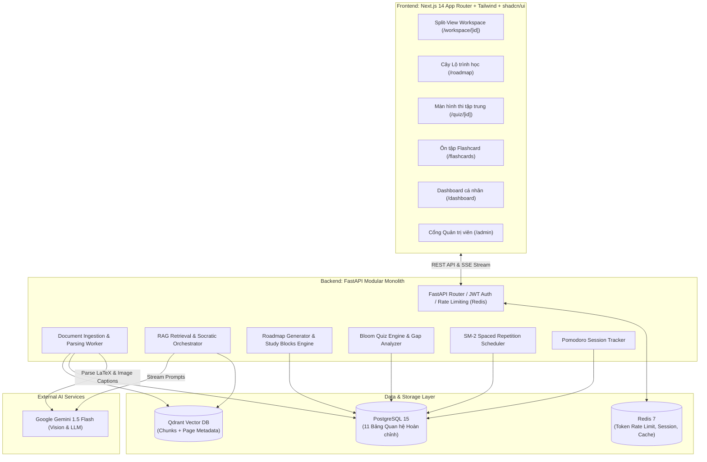
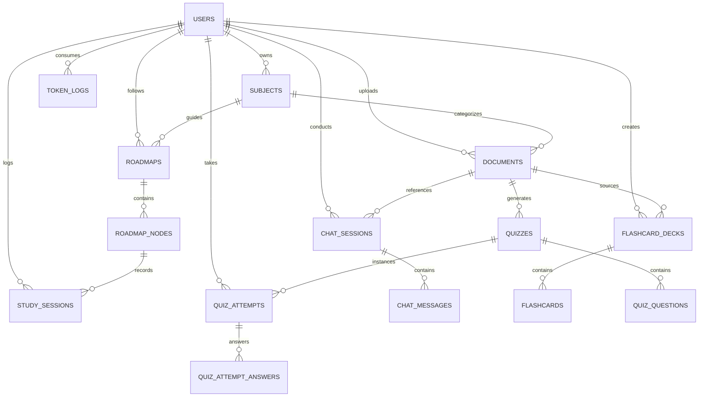

# TÀI LIỆU THIẾT KẾ HỆ THỐNG VÀ KẾ HOẠCH TRIỂN KHAI THEO SPRINT
## DỰ ÁN: NỀN TẢNG HỌC TẬP CÁ NHÂN HÓA TÍCH HỢP AI (AI LEARNING PLATFORM - LMS)

---

| **Thông tin dự án** | **Chi tiết** |
| :--- | :--- |
| **Loại hình dự án** | Bài tập lớn Project 1 |
| **Thời gian thực hiện** | 4 Sprints |
| **Nhân sự thực hiện** | 3 thành viên: **Long** (AI Lead), **Khoa** (Full-stack Study Engine), **Sơn** (Full-stack Workspace) |
| **Kiến trúc hệ thống** | Modular Monolith (Monorepo) |
| **Tech Stack** | Next.js 14, Tailwind CSS, shadcn/ui, FastAPI, LlamaIndex, PostgreSQL 15, Qdrant, Redis 7, Google Gemini 1.5 Flash |
| **Design System** | Cold Tone (Primary Indigo-600, Slate-50/950, Emerald/Rose/Amber), Lucide Icons, KaTeX, Inter/Geist UI |
| **Phiên bản tài liệu** | 2.0 |

---

## MỤC LỤC
1. [TỔNG QUAN VÀ BỐI CẢNH DỰ ÁN](#1-tổng-quan-và-bối-cảnh-dự-án)
2. [KIẾN TRÚC HỆ THỐNG VÀ CÔNG NGHỆ](#2-kiến-trúc-hệ-thống-và-công-nghệ)
3. [THIẾT KẾ CƠ SỞ DỮ LIỆU ĐẦY ĐỦ (COMPLETE DATABASE SCHEMA)](#3-thiết-kế-cơ-sở-dữ-liệu-đầy-đủ-complete-database-schema)
   - 3.1. Sơ đồ Quan hệ PostgreSQL (11 Bảng chuẩn hóa)
   - 3.2. Cấu trúc Payload & Indexing trong Qdrant Vector DB
   - 3.3. Cấu trúc Caching & Session trong Redis
4. [THIẾT KẾ CÁC MODULE THUẬT TOÁN & SƯ PHẠM](#4-thiết-kế-các-module-thuật-toán--sư-phạm)
   - 4.1. Pipeline Ingestion & RAG xử lý Công thức (LaTeX) / Hình ảnh
   - 4.2. Bộ điều phối Socratic Mode 3 tầng & Chống gian lận
   - 4.3. Thuật toán Lộ trình học & Study Blocks (Constraint Allocation)
   - 4.4. Thuật toán Spaced Repetition (SuperMemo SM-2)
   - 4.5. Sinh bài kiểm tra phân cấp Bloom & Trộn đề Interleaving
5. [THIẾT KẾ GIAO DIỆN VÀ TRẢI NGHIỆM (UI/UX DESIGN SYSTEM)](#5-thiết-kế-giao-diện-và-trải-nghiệm-uiux-design-system)
6. [CỔNG QUẢN TRỊ VIÊN (ADMIN PORTAL & AN TOÀN HỆ THỐNG)](#6-cổng-quản-trị-viên-admin-portal--an-toàn-hệ-thống)
7. [CHIẾN LƯỢC XỬ LÝ LỖI & SUY THOÁI MỀM (GRACEFUL DEGRADATION)](#7-chiến-lược-xử-lý-lỗi--suy-thoái-mềm-graceful-degradation)
8. [KẾ HOẠCH TRIỂN KHAI CHI TIẾT THEO 4 SPRINT (8 TUẦN)](#8-kế-hoạch-triển-khai-chi-tiết-theo-4-sprint-8-tuần)
   - [Sprint 1 (Tuần 1–2): Nền tảng Hạ tầng, Database Schema, Ingestion & UI Scaffold](#sprint-1-tuần-12-nền-tảng-hạ-tầng-database-schema-ingestion--ui-scaffold)
   - [Sprint 2 (Tuần 3–4): Split-View Workspace, RAG Streaming Dẫn Nguồn, Socratic & Roadmap Cây](#sprint-2-tuần-34-split-view-workspace-rag-streaming-dẫn-nguồn-socratic--roadmap-cây)
   - [Sprint 3 (Tuần 5–6): Màn hình Quiz Bloom, Thuật toán SM-2, Pomodoro & Admin User Portal](#sprint-3-tuần-56-màn-hình-quiz-bloom-thuật-toán-sm-2-pomodoro--admin-user-portal)
   - [Sprint 4 (Tuần 7–8): Kiểm thử Toàn diện, Dashboard Analytics, Bảo vệ Prompt Injection & Tổng duyệt Demo](#sprint-4-tuần-78-kiểm-thử-toàn-diện-dashboard-analytics-bảo-vệ-prompt-injection--tổng-duyệt-demo)
9. [TIÊU CHÍ NGHIỆM THU & KỊCH BẢN BẢO VỆ ĐỒ ÁN](#9-tiêu-chí-nghiệm-thu--kịch-bản-bảo-vệ-đồ-án)

---

## 1. TỔNG QUAN VÀ BỐI CẢNH DỰ ÁN

### 1.1. Vấn đề thực tế (Problem Statement)
Sinh viên và người tự học đối mặt với 3 thách thức lớn khi tiếp cận tài liệu chuyên môn dài:
1. **Thiếu định hướng & Dễ mất tập trung:** Không có người hướng dẫn chia nhỏ mục tiêu theo thời gian rảnh và theo dõi sự tập trung.
2. **Học thụ động & Phụ thuộc AI:** Các chatbot thông thường (như ChatGPT) giải hộ toàn bộ bài tập, khiến người học mất đi tư duy phản biện và khả năng tự suy luận.
3. **Ảo giác thông tin (Hallucination) & Mau quên:** Chatbot đưa ra câu trả lời không kèm nguồn kiểm chứng, người học không ôn tập định kỳ dẫn đến đường cong lãng quên (Ebbinghaus Forgetting Curve).

### 1.2. Mục tiêu giải pháp
Xây dựng nền tảng học tập **AI Learning Platform** kết hợp kiến trúc RAG với các lý thuyết sư phạm thực nghiệm đã được công nhận quốc tế:
* **Vygotsky Scaffolding & Socratic Method:** Gợi mở từng bước theo 3 tầng (Lý thuyết $\rightarrow$ Bài mẫu $\rightarrow$ Hướng dẫn từng bước).
* **Cây Lộ trình học (Roadmap Tree) & Study Blocks:** Chia nhỏ bài học thành các khối thời gian 15–30 phút hoặc 45–90 phút (Pomodoro).
* **Thang đo nhận thức Bloom:** Phân cấp câu hỏi kiểm tra từ Nhận biết/Hiểu $\rightarrow$ Vận dụng $\rightarrow$ Phân tích và chỉ rõ lỗ hổng kiến thức.
* **Thuật toán SuperMemo SM-2:** Tối ưu hóa chu kỳ ôn tập thẻ ghi nhớ (Flashcard).
* **Workspace Split-View:** Đồng bộ giữa trình đọc PDF và AI Chatbot có trích dẫn số trang trực tiếp.

### 1.3. Phạm vi tinh gọn (De-scoped / Non-goals)
Để bảo đảm hoàn thành chất lượng cao trong 8 tuần:
* **Cắt giảm thương mại:** Không tích hợp cổng thanh toán thực tế (VNPay/Momo/Stripe) và Quản lý doanh thu gói cước. Hệ thống cấp sẵn token định danh cho tài khoản demo.
* **Không làm OCR mô hình nặng nội bộ:** Sử dụng trực tiếp Gemini 1.5 Flash Vision API để nhận diện công thức toán LaTeX và sinh caption hình ảnh.
* **Không làm Microservices:** Toàn bộ dự án đi theo mô hình Modular Monolith đồng nhất.

---

## 2. KIẾN TRÚC HỆ THỐNG VÀ CÔNG NGHỆ



---

## 3. THIẾT KẾ CƠ SỞ DỮ LIỆU ĐẦY ĐỦ (COMPLETE DATABASE SCHEMA)

Hệ thống cơ sở dữ liệu quan hệ được thiết kế chuẩn hóa bậc 3 (3NF) gồm **11 bảng**, đáp ứng 100% các User Stories trong SRS:



### 3.1. Sơ đồ Quan hệ PostgreSQL (DDL Chi Tiết)

```sql
-- ============================================================================
-- 1. MODULE NGƯỜI DÙNG & BẢO MẬT (USERS & SECURITY)
-- ============================================================================
CREATE TABLE users (
    id UUID PRIMARY KEY DEFAULT gen_random_uuid(),
    email VARCHAR(255) UNIQUE NOT NULL,
    hashed_password VARCHAR(255) NOT NULL,
    full_name VARCHAR(100),
    role VARCHAR(20) DEFAULT 'user',               -- 'user', 'admin'
    is_active BOOLEAN DEFAULT TRUE,                -- Admin có thể khóa (Suspend)
    daily_token_limit INT DEFAULT 50000,
    used_token_today INT DEFAULT 0,
    created_at TIMESTAMP WITH TIME ZONE DEFAULT CURRENT_TIMESTAMP,
    updated_at TIMESTAMP WITH TIME ZONE DEFAULT CURRENT_TIMESTAMP
);

-- ============================================================================
-- 2. MODULE MÔN HỌC & TÀI LIỆU (SUBJECTS & DOCUMENTS - FR-01, FR-02)
-- ============================================================================
CREATE TABLE subjects (
    id UUID PRIMARY KEY DEFAULT gen_random_uuid(),
    user_id UUID REFERENCES users(id) ON DELETE CASCADE,
    name VARCHAR(150) NOT NULL,                    -- Ví dụ: Toán Cao Cấp, Cấu trúc Dữ liệu
    code VARCHAR(50),
    description TEXT,
    color_hex VARCHAR(10) DEFAULT '#4F46E5',       -- Màu hiển thị trên Dashboard
    created_at TIMESTAMP WITH TIME ZONE DEFAULT CURRENT_TIMESTAMP
);

CREATE TABLE documents (
    id UUID PRIMARY KEY DEFAULT gen_random_uuid(),
    user_id UUID REFERENCES users(id) ON DELETE CASCADE,
    subject_id UUID REFERENCES subjects(id) ON DELETE SET NULL, -- Gán vào môn học
    title VARCHAR(255) NOT NULL,
    file_path VARCHAR(500) NOT NULL,
    file_type VARCHAR(10) NOT NULL,                -- 'pdf', 'docx', 'txt'
    file_size_kb INT NOT NULL,
    total_pages INT DEFAULT 1,
    is_public BOOLEAN DEFAULT FALSE,               -- True: Tài liệu chung của Admin
    status VARCHAR(30) DEFAULT 'uploading',        -- 'uploading', 'parsing', 'indexing', 'ready', 'failed'
    error_message TEXT,
    created_at TIMESTAMP WITH TIME ZONE DEFAULT CURRENT_TIMESTAMP
);

-- ============================================================================
-- 3. MODULE LỘ TRÌNH HỌC TẬP (ROADMAPS & STUDY BLOCKS - FR-12 -> FR-15)
-- ============================================================================
CREATE TABLE roadmaps (
    id UUID PRIMARY KEY DEFAULT gen_random_uuid(),
    user_id UUID REFERENCES users(id) ON DELETE CASCADE,
    subject_id UUID REFERENCES subjects(id) ON DELETE CASCADE,
    title VARCHAR(255) NOT NULL,                   -- Ví dụ: Lộ trình Giải tích trong 4 tuần
    target_date DATE,
    available_hours_per_day FLOAT DEFAULT 2.0,
    progress_percentage FLOAT DEFAULT 0.0,
    status VARCHAR(20) DEFAULT 'active',           -- 'active', 'completed', 'behind_schedule'
    created_at TIMESTAMP WITH TIME ZONE DEFAULT CURRENT_TIMESTAMP
);

CREATE TABLE roadmap_nodes (
    id UUID PRIMARY KEY DEFAULT gen_random_uuid(),
    roadmap_id UUID REFERENCES roadmaps(id) ON DELETE CASCADE,
    parent_node_id UUID REFERENCES roadmap_nodes(id) ON DELETE CASCADE, -- Cây phân cấp
    document_id UUID REFERENCES documents(id) ON DELETE SET NULL,
    title VARCHAR(255) NOT NULL,
    description TEXT,
    order_index INT NOT NULL,
    target_page_start INT,
    target_page_end INT,
    estimated_minutes INT DEFAULT 30,              -- 15-30p hoặc 45-90p (Study Block)
    is_unlocked BOOLEAN DEFAULT FALSE,             -- Mở khóa tuần tự
    is_completed BOOLEAN DEFAULT FALSE,
    completed_at TIMESTAMP WITH TIME ZONE
);

-- ============================================================================
-- 4. MODULE PHIÊN HỌC POMODORO (STUDY SESSIONS - FR-16, FR-18, FR-26)
-- ============================================================================
CREATE TABLE study_sessions (
    id UUID PRIMARY KEY DEFAULT gen_random_uuid(),
    user_id UUID REFERENCES users(id) ON DELETE CASCADE,
    subject_id UUID REFERENCES subjects(id) ON DELETE SET NULL,
    document_id UUID REFERENCES documents(id) ON DELETE SET NULL,
    roadmap_node_id UUID REFERENCES roadmap_nodes(id) ON DELETE SET NULL,
    duration_minutes INT NOT NULL,                 -- Thời lượng học thực tế
    session_type VARCHAR(20) DEFAULT 'pomodoro',   -- 'pomodoro', 'free_study'
    completed_at TIMESTAMP WITH TIME ZONE DEFAULT CURRENT_TIMESTAMP
);

-- ============================================================================
-- 5. MODULE HỘI THOẠI AI TUTOR (CHAT SESSIONS & MESSAGES - FR-04, FR-05, FR-07)
-- ============================================================================
CREATE TABLE chat_sessions (
    id UUID PRIMARY KEY DEFAULT gen_random_uuid(),
    user_id UUID REFERENCES users(id) ON DELETE CASCADE,
    document_id UUID REFERENCES documents(id) ON DELETE CASCADE,
    title VARCHAR(255) DEFAULT 'Hội thoại mới',
    created_at TIMESTAMP WITH TIME ZONE DEFAULT CURRENT_TIMESTAMP
);

CREATE TABLE chat_messages (
    id UUID PRIMARY KEY DEFAULT gen_random_uuid(),
    session_id UUID REFERENCES chat_sessions(id) ON DELETE CASCADE,
    sender VARCHAR(20) NOT NULL,                   -- 'user', 'assistant'
    content TEXT NOT NULL,
    socratic_tier INT DEFAULT 0,                   -- 0: Normal, 1: Hint lý thuyết, 2: Bài mẫu, 3: Từng bước
    citations JSONB DEFAULT '[]'::jsonb,           -- [{"page": 14, "quote": "...", "file_id": "..."}]
    token_count INT DEFAULT 0,
    created_at TIMESTAMP WITH TIME ZONE DEFAULT CURRENT_TIMESTAMP
);

-- ============================================================================
-- 6. MODULE THẺ GHI NHỚ & SM-2 (FLASHCARDS - FR-22, FR-23, FR-24)
-- ============================================================================
CREATE TABLE flashcard_decks (
    id UUID PRIMARY KEY DEFAULT gen_random_uuid(),
    user_id UUID REFERENCES users(id) ON DELETE CASCADE,
    subject_id UUID REFERENCES subjects(id) ON DELETE CASCADE,
    document_id UUID REFERENCES documents(id) ON DELETE SET NULL,
    title VARCHAR(150) NOT NULL,
    description TEXT,
    created_at TIMESTAMP WITH TIME ZONE DEFAULT CURRENT_TIMESTAMP
);

CREATE TABLE flashcards (
    id UUID PRIMARY KEY DEFAULT gen_random_uuid(),
    deck_id UUID REFERENCES flashcard_decks(id) ON DELETE CASCADE,
    user_id UUID REFERENCES users(id) ON DELETE CASCADE,
    front_text TEXT NOT NULL,                      -- Khái niệm / Công thức (hỗ trợ LaTeX)
    back_text TEXT NOT NULL,                       -- Giải nghĩa / Định lý
    page_number INT,                               -- Trang nguồn
    repetition_number INT DEFAULT 0,
    easiness_factor FLOAT DEFAULT 2.5,             -- Hệ số dễ nhớ SM-2
    interval_days INT DEFAULT 1,                   -- Khoảng cách ngày ôn
    due_date DATE DEFAULT CURRENT_DATE,            -- Ngày cần ôn tiếp theo
    created_at TIMESTAMP WITH TIME ZONE DEFAULT CURRENT_TIMESTAMP
);

-- ============================================================================
-- 7. MODULE BÀI KIỂM TRA BLOOM (QUIZZES & ATTEMPTS - FR-19, FR-20, FR-21)
-- ============================================================================
CREATE TABLE quizzes (
    id UUID PRIMARY KEY DEFAULT gen_random_uuid(),
    user_id UUID REFERENCES users(id) ON DELETE CASCADE,
    document_id UUID REFERENCES documents(id) ON DELETE CASCADE,
    subject_id UUID REFERENCES subjects(id) ON DELETE SET NULL,
    title VARCHAR(255) NOT NULL,
    is_interleaved BOOLEAN DEFAULT FALSE,          -- Trộn kiến thức cũ/mới
    total_questions INT NOT NULL,
    time_limit_minutes INT DEFAULT 15,
    created_at TIMESTAMP WITH TIME ZONE DEFAULT CURRENT_TIMESTAMP
);

CREATE TABLE quiz_questions (
    id UUID PRIMARY KEY DEFAULT gen_random_uuid(),
    quiz_id UUID REFERENCES quizzes(id) ON DELETE CASCADE,
    question_text TEXT NOT NULL,
    bloom_level VARCHAR(30) NOT NULL,              -- 'remember_understand', 'apply', 'analyze'
    options JSONB NOT NULL,                        -- [{"key": "A", "text": "..."}, {"key": "B", "text": "..."}]
    correct_option VARCHAR(5) NOT NULL,
    explanation TEXT,
    target_page INT,                               -- Trang tài liệu chứa kiến thức
    topic_tag VARCHAR(100)                         -- Chủ đề để thống kê lỗ hổng
);

CREATE TABLE quiz_attempts (
    id UUID PRIMARY KEY DEFAULT gen_random_uuid(),
    quiz_id UUID REFERENCES quizzes(id) ON DELETE CASCADE,
    user_id UUID REFERENCES users(id) ON DELETE CASCADE,
    score FLOAT NOT NULL,                          -- Điểm số thang 10 hoặc 100
    total_correct INT NOT NULL,
    total_incorrect INT NOT NULL,
    started_at TIMESTAMP WITH TIME ZONE DEFAULT CURRENT_TIMESTAMP,
    completed_at TIMESTAMP WITH TIME ZONE DEFAULT CURRENT_TIMESTAMP
);

CREATE TABLE quiz_attempt_answers (
    id UUID PRIMARY KEY DEFAULT gen_random_uuid(),
    attempt_id UUID REFERENCES quiz_attempts(id) ON DELETE CASCADE,
    question_id UUID REFERENCES quiz_questions(id) ON DELETE CASCADE,
    selected_option VARCHAR(5) NOT NULL,
    is_correct BOOLEAN NOT NULL
);

-- ============================================================================
-- 8. MODULE GIÁM SÁT TOKEN & AN TOÀN (TOKEN & AUDIT LOGS - FR-28, FR-29)
-- ============================================================================
CREATE TABLE token_usage_logs (
    id UUID PRIMARY KEY DEFAULT gen_random_uuid(),
    user_id UUID REFERENCES users(id) ON DELETE SET NULL,
    action_type VARCHAR(50) NOT NULL,              -- 'chat_socratic', 'generate_quiz', 'extract_flashcard', 'ingest_pdf'
    input_tokens INT NOT NULL,
    output_tokens INT NOT NULL,
    total_tokens INT NOT NULL,
    estimated_cost_usd NUMERIC(8, 6),
    is_prompt_injection_flagged BOOLEAN DEFAULT FALSE,
    created_at TIMESTAMP WITH TIME ZONE DEFAULT CURRENT_TIMESTAMP
);

-- ============================================================================
-- CÁC CHỈ MỤC TỐI ƯU TRUY VẤN (INDEXES)
-- ============================================================================
CREATE INDEX idx_documents_user_id ON documents(user_id);
CREATE INDEX idx_documents_subject_id ON documents(subject_id);
CREATE INDEX idx_roadmap_nodes_roadmap_id ON roadmap_nodes(roadmap_id);
CREATE INDEX idx_study_sessions_user_date ON study_sessions(user_id, completed_at);
CREATE INDEX idx_chat_messages_session_id ON chat_messages(session_id);
CREATE INDEX idx_flashcards_user_due ON flashcards(user_id, due_date);
CREATE INDEX idx_quiz_questions_quiz_id ON quiz_questions(quiz_id);
CREATE INDEX idx_token_usage_created_at ON token_usage_logs(created_at);
```

### 3.2. Cấu trúc Payload & Indexing trong Qdrant Vector DB
* **Collection Name:** `learning_chunks`
* **Vector Configuration:** Size = 768 (`Google text-embedding-004`), Distance = `Cosine`.
* **Payload Fields:**
  ```json
  {
    "doc_id": "c3b8f1a2-9b21-4d33-bc89-123456789abc",
    "user_id": "9d10e542-4f32-4e12-8921-987654321def",
    "subject_id": "5e12a431-7b11-4a11-8933-abcdef123456",
    "page_number": 14,
    "chunk_index": 3,
    "has_formula": true,
    "has_image_caption": false,
    "is_public": false,
    "text_content": "Định lý 2.1: Cho hàm số f(x)... Công thức: $$f'(x) = \\lim_{h \\to 0} \\frac{f(x+h) - f(x)}{h}$$"
  }
  ```

---

## 4. THIẾT KẾ CÁC MODULE THUẬT TOÁN & SƯ PHẠM

### 4.1. Pipeline Ingestion & RAG xử lý Công thức (LaTeX) / Hình ảnh
1. **Trích xuất thông minh (Gemini Flash Vision):** Gửi từng trang PDF tới Gemini Vision:
   * Giữ nguyên cấu trúc văn bản.
   * Toàn bộ công thức toán học nội dòng hoặc dạng khối bắt buộc bọc trong cú pháp LaTeX chuẩn (`$...$` hoặc `$$...$$`).
   * Sơ đồ, biểu đồ kỹ thuật được mô tả bằng khối: `[Hình vẽ trang X: <Tóm tắt ý nghĩa sơ đồ>]`.
2. **Chunking Phân cấp (Hierarchical Chunking):**
   * Sử dụng LlamaIndex `SentenceSplitter` (chunk size = 768 tokens, overlap = 100 tokens).
   * Mỗi chunk luôn kế thừa `page_number` của trang PDF chứa nó để đảm bảo việc trích dẫn trang nguồn chính xác 100%.

### 4.2. Bộ điều phối Socratic Mode 3 tầng & Chống gian lận
Khi phát hiện câu hỏi chứa đề thi hoặc bài tập về nhà, AI không đưa lời giải mà kích hoạt bộ gợi mở:
* **Tầng 1 (Nhắc lý thuyết):** Trích dẫn công thức/định nghĩa từ trang sách tương ứng và hỏi: *"Để giải bài toán này, bạn nhớ định lý/công thức nào liên quan ở Trang X không?"*
* **Tầng 2 (Bài mẫu tương tự):** Đưa ra một bài toán số liệu khác đơn giản hơn và làm mẫu quy trình tư duy.
* **Tầng 3 (Dẫn dắt từng bước):** Yêu cầu người học tính toán bước đầu tiên: *"Bước 1: Ta cần tìm ẩn X trước, theo bạn X bằng bao nhiêu?"*

### 4.3. Thuật toán Lộ trình học & Study Blocks (Constraint Allocation)
* **Đầu vào:** Mục tiêu môn học, thời gian rảnh mỗi ngày (ví dụ: 1.5 giờ/ngày) và số ngày mục tiêu.
* **Thuật toán phân bổ:**
  1. AI phân tích mục lục tài liệu thành cây phân cấp các chủ đề (Topics/Subtopics).
  2. Chia nhỏ thành các **Study Blocks** chuẩn Pomodoro: 25 phút đọc lý thuyết + 5 phút nghỉ; hoặc 50 phút luyện tập + 10 phút nghỉ.
  3. Mở khóa tuần tự (`is_unlocked = true`): Chỉ khi hoàn thành bài trước (hoặc làm đạt Quiz > 70%) thì mới mở khóa chặng tiếp theo.
  4. Nếu trễ tiến độ (tiến độ thực tế < tiến độ dự kiến 3 ngày), thuật toán tự động tính toán lại và dời lịch các chặng sau.

### 4.4. Thuật toán Spaced Repetition (SuperMemo SM-2)
* Người dùng đánh giá độ nhớ sau khi lật thẻ $q \in \{0, 1, 2, 3, 4, 5\}$:
  $$\text{EF}' = \text{EF} + (0.1 - (5 - q) \times (0.08 + (5 - q) \times 0.02)) \quad (\text{với } \text{EF}' \ge 1.3)$$
* Tính khoảng cách ngày ôn tiếp theo ($I$):
  $$I(1) = 1\text{ ngày}, \quad I(2) = 6\text{ ngày}, \quad I(n) = I(n-1) \times \text{EF}'$$
* Cập nhật: `due_date = current_date + I(n)`. Dashboard lọc ra các thẻ có `due_date <= today` để nhắc nhở.

### 4.5. Sinh bài kiểm tra phân cấp Bloom & Trộn đề Interleaving
* Dùng Structured Output (Pydantic Schema) sinh 5–10 câu trắc nghiệm theo 3 cấp độ Bloom:
  * **Cấp 1 (Ghi nhớ / Hiểu - 40%):** Định nghĩa, nhận diện công thức toán.
  * **Cấp 2 (Vận dụng - 40%):** Bài toán tính toán cụ thể.
  * **Cấp 3 (Phân tích - 20%):** Tìm lỗi sai trong lập luận hoặc so sánh khái niệm.
* **Interleaving:** Tự động trộn 70% câu hỏi bài hiện tại với 30% câu hỏi của các bài học tuần trước để rèn luyện phản xạ liên kết kiến thức.
* Khi nộp bài, hệ thống trích xuất `target_page` của các câu sai để người học bấm nút chuyển thẳng về Workspace đọc lại.

---

## 5. THIẾT KẾ GIAO DIỆN VÀ TRẢI NGHIỆM (UI/UX DESIGN SYSTEM)

Theo quy chuẩn tại tài liệu thiết kế giao diện:
* **Tone màu:** Màu Lạnh (Cold Tone) tạo sự tập trung.
  * Primary: **Indigo** (`bg-indigo-600`, `text-indigo-600`).
  * Nền: Light (`bg-slate-50`, thẻ `bg-white`) / Dark (`bg-slate-950`, thẻ `bg-slate-900`).
  * Trạng thái: Emerald (Đúng/Thành công), Amber (Cảnh báo/Hết giờ), Rose (Sai/Lỗi).
* **Nghệ thuật chữ:** Font UI dùng **Inter / Geist**; Font Code dùng **Fira Code / JetBrains Mono**; Render công thức bằng **KaTeX**.
* **Thẻ trích dẫn (Citation Pill):** Dạng viên thuốc nổi bật: `rounded-full text-xs bg-indigo-100 text-indigo-700 px-2 py-1 hover:bg-indigo-200 cursor-pointer`.
* **5 Màn hình cốt lõi:**
  1. `/workspace/[id]`: Split-View 50/50 kéo thả resize (PDF viewer bên trái, Chatbot streaming KaTeX bên phải, Pomodoro nổi).
  2. `/roadmap`: Sơ đồ cây lộ trình học phân cấp, hiển thị tiến độ % và các khối Study Blocks.
  3. `/quiz/[id]`: Chế độ Focus Mode toàn màn hình, đếm ngược thời gian, trang kết quả chỉ rõ câu sai kèm link ôn tập.
  4. `/flashcards`: Lật thẻ 3D hai mặt, 4 nút đánh giá độ nhớ theo SM-2.
  5. `/dashboard`: Biểu đồ thời gian học theo môn (Recharts), chuỗi ngày học liên tục (Streak) và số thẻ cần ôn.

---

## 6. CỔNG QUẢN TRỊ VIÊN (ADMIN PORTAL & AN TOÀN HỆ THỐNG)

Cổng `/admin` dành riêng cho quản trị viên với 3 khu vực chức năng:
1. **Quản lý Tài khoản & Khóa người dùng (`/admin/users`):** Danh sách người dùng, số token đã tiêu thụ, nút **"Khóa tài khoản" (Suspend)** khi có dấu hiệu phá hoại prompt injection và nút **"Reset / Tăng Token"**.
2. **Giám sát Chi phí & Token API (`/admin/analytics`):** Biểu đồ lượng Token (Input/Output) theo ngày và bảng ước tính chi phí API (USD / VNĐ).
3. **Quản lý Tài liệu dùng chung (`/admin/documents`):** Tải lên các tài liệu giáo trình chung (`is_public = true`) để toàn trường cùng khai thác.

---

## 7. CHIẾN LƯỢC XỬ LÝ LỖI & SUY THOÁI MỀM (GRACEFUL DEGRADATION)

| Sự cố | Cơ chế xử lý kỹ thuật | Trải nghiệm người dùng |
| :--- | :--- | :--- |
| **API AI hết Token / Quota (Lỗi 429)** | Hiển thị thông báo nhẹ nhàng kèm nút `[Thử lại]`. |
| **Mất mạng / Server AI Timeout** | Tự động thử lại 2 lần (Exponential backoff: 1s, 2s). | Khung chat hiển thị toast: *"Kết nối AI tạm gián đoạn. Bạn vẫn có thể tiếp tục đọc tài liệu bình thường."* |
| **Hệ thống vẫn hoạt động khi AI lỗi** | Tách rời tính năng AI khỏi các chức năng đọc và quản lý. | **Người dùng vẫn đọc được PDF, bấm giờ Pomodoro, ôn tập Flashcard cũ và xem Dashboard bình thường 100%.** |
| **Tài liệu tải lên bị lỗi format** | Ingestion worker bắt lỗi, đánh dấu `status = 'failed'` trong DB. | Hiển thị nhãn đỏ *"Xử lý lỗi - Vui lòng tải lại file PDF chuẩn văn bản"* kèm nút thử lại. |

---

## 8. KẾ HOẠCH TRIỂN KHAI CHI TIẾT THEO 4 SPRINT (8 TUẦN)

### Phân vai 3 thành viên:
* **Thành viên 1: Long (AI Lead & Backend AI Infrastructure):** Chuyên trách toàn bộ Ingestion (PDF, LaTeX, caption ảnh), Vector DB Qdrant, LlamaIndex RAG, Socratic 3 tầng, Structured Outputs (Quiz Bloom, Flashcard) và lọc Prompt Injection.
* **Thành viên 2: Khoa (Full-stack: Study Engine & Roadmap):** Chuyên trách thuật toán sinh cây lộ trình học (FR-12), chia nhỏ Study Blocks (FR-13), cài đặt thuật toán SM-2 (FR-23), logic trộn bài Interleaving (FR-20) và API tích lũy giờ học Pomodoro.
* **Thành viên 3: Sơn (Full-stack: Workspace UI):** Chuyên trách giao diện Next.js Split-View Workspace (PDF viewer cuộn trang, chat KaTeX), màn hình làm bài `/quiz/[id]`, Dashboard biểu đồ, Cổng Admin `/admin` và Rate Limiting.

---

### SPRINT 1 (Tuần 1–2): Nền tảng Hạ tầng, Database Schema, Ingestion & UI Scaffold
> **Mục tiêu Sprint:** Khởi động trơn tru toàn bộ hạ tầng Docker, hoàn thiện 11 bảng PostgreSQL, bóc tách được tài liệu PDF chứa công thức LaTeX và dựng bộ khung giao diện Next.js chuẩn Design System.

#### Nhiệm vụ cụ thể:
* **Long (AI Lead):**
  * Khởi tạo Docker Compose: Chạy ổn định PostgreSQL 15, Qdrant, Redis 7.
  * Cài đặt môi trường Python backend với `uv` (`fastapi`, `llamaindex`, `qdrant-client`, `google-generativeai`).
  * Viết Ingestion Worker: Gửi từng trang PDF sang Gemini Flash Vision để trích xuất text, giữ nguyên công thức LaTeX (`$...$`) và sinh caption ảnh.
  * Cấu hình LlamaIndex kết nối collection `learning_chunks` trên Qdrant với metadata `page_number`, `doc_id`.
* **Khoa (Full-stack Study Engine):**
  * Khởi tạo cơ sở dữ liệu PostgreSQL từ DDL 11 bảng đầy đủ (sử dụng Alembic / SQLAlchemy 2.0 Async).
  * Viết module xác thực người dùng: Đăng ký, Đăng nhập, mã hóa bcrypt và cấp phát JWT token.
  * Thiết kế thuật toán sinh cấu trúc cây lộ trình học ban đầu (Roadmap Tree) từ mục tiêu học tập (FR-12).
* **Sơn (Full-stack Workspace):**
  * Khởi tạo dự án Next.js 14 với Tailwind CSS, cài đặt shadcn/ui và Lucide React theo đúng bảng màu Indigo/Slate.
  * Xây dựng màn hình Đăng nhập/Đăng ký và Trang Quản lý tài liệu cá nhân (kèm nút Upload file PDF).
  * Viết API upload file: `POST /api/documents/upload` lưu file vào ổ đĩa và ghi nhận trạng thái vào bảng `documents`.
  * Dựng khung bố cục chia đôi màn hình Split-View (50/50).

#### Tiêu chí nghiệm thu Sprint 1 (DoD):
* [x] Docker Compose chạy thành công 3 container: Postgres (5432), Qdrant (6333), Redis (6379).
* [x] Upload 1 file PDF giáo trình mẫu $\rightarrow$ Backend bóc tách thành công văn bản có công thức LaTeX và lưu vector vào Qdrant kèm số trang.
* [x] Người dùng đăng nhập được và nhìn thấy danh sách tài liệu cá nhân.

---

### SPRINT 2 (Tuần 3–4): Split-View Workspace, RAG Streaming Dẫn Nguồn, Socratic & Roadmap Cây
> **Mục tiêu Sprint:** Người học có thể vừa đọc PDF vừa chat với AI; AI trả lời trích dẫn số trang; bấm trích dẫn PDF tự động cuộn trang; AI hoạt động theo chế độ gợi mở Socratic 3 tầng; hiển thị sơ đồ cây lộ trình học.

#### Nhiệm vụ cụ thể:
* **Long (AI Lead):**
  * Xây dựng pipeline truy vấn RAG qua LlamaIndex: Tìm top-k chunks liên quan từ Qdrant theo `doc_id`.
  * Thiết kế System Prompt cho **Socratic Mode 3 tầng** và bộ lọc phát hiện bài tập về nhà.
  * Cấu hình Server-Sent Events (SSE) để stream câu trả lời thời gian thực kèm thẻ trích dẫn `[[Trang X]]`.
  * Thiết lập cơ chế Fallback API Key khi gặp lỗi quota 429.
* **Khoa (Full-stack Study Engine):**
  * Hoàn thiện API và logic chia nhỏ **Study Blocks** 15–30 phút hoặc 45–90 phút theo khung giờ rảnh (FR-13).
  * Viết logic cập nhật trạng thái bài học (`is_unlocked`, `is_completed`) để mở khóa chặng tiếp theo trên Roadmap (FR-14).
  * Xây dựng API phiên học Pomodoro (`POST /api/study-sessions`) ghi nhận thời gian học thực tế theo môn.
* **Sơn (Full-stack Workspace):**
  * Tích hợp thư viện PDF.js / react-pdf vào cột trái của Workspace.
  * Lập trình sự kiện click vào thẻ trích dẫn `[[Trang X]]` trong chatbox $\rightarrow$ Trình đọc PDF tự động cuộn đến trang X và hiển thị viền highlight.
  * Tích hợp `react-markdown` và `rehype-katex` để render công thức toán học và bảng biểu mượt mà.
  * Dựng giao diện cây Lộ trình học (`/roadmap`) hiển thị các khối Study Blocks và tiến độ hoàn thành.

#### Tiêu chí nghiệm thu Sprint 2 (DoD):
* [x] Split-View Workspace hoạt động mượt mà: Chat stream câu trả lời, công thức toán LaTeX hiển thị chuẩn xác.
* [x] Bấm vào thẻ trích dẫn `[[Trang X]]`, PDF viewer bên trái cuộn ngay đến trang tương ứng.
* [x] Dán đề bài tập khó, AI kích hoạt Socratic Tầng 1 (nhắc lại định lý liên quan ở trang nguồn) thay vì giải hộ.
* [x] Cây lộ trình học hiển thị rõ ràng các bài học và khối thời gian Pomodoro.

---

### SPRINT 3 (Tuần 5–6): Màn hình Quiz Bloom, Thuật toán SM-2, Pomodoro & Admin User Portal
> **Mục tiêu Sprint:** Tạo chu trình học tập khép kín: Sinh Quiz theo thang Bloom trên màn hình độc lập `/quiz/[id]`; nộp bài chỉ ra lỗ hổng và dẫn ngược về trang sách; thuật toán SM-2 tính ngày ôn Flashcard; Widget Pomodoro nổi; Cổng Admin quản lý tài khoản.

#### Nhiệm vụ cụ thể:
* **Long (AI Lead):**
  * Xây dựng endpoint sinh Quiz: Dùng Gemini Structured Output (Pydantic Schema) sinh 5–10 câu trắc nghiệm theo 3 cấp độ Bloom từ tài liệu hiện tại, đính kèm `target_page` và `topic_tag`.
  * Xây dựng endpoint trích xuất tự động các cặp Flashcard (Thuật ngữ - Định nghĩa/Công thức) từ nội dung bài học.
  * Bổ sung tính năng AI Đảo vai (Reverse Tutoring) thử nghiệm (FR-11).
* **Khoa (Full-stack Study Engine):**
  * Cài đặt **Thuật toán SuperMemo SM-2**: Viết hàm cập nhật `easiness_factor`, `interval_days` và `due_date` khi người dùng đánh giá thẻ ghi nhớ (0-5 sao).
  * Lập trình logic **Trộn bài kiểm tra (Interleaving Practice)**: Tự động kết hợp 70% câu hỏi bài mới và 30% câu hỏi bài cũ (FR-20).
  * Viết logic phân tích kết quả thi: Xác định danh sách các `topic_tag` bị hổng và trả về các trang sách cần đọc lại (FR-21).
* **Sơn (Full-stack Workspace):**
  * Xây dựng **Màn hình kiểm tra độc lập (`/quiz/[id]`)**: Chế độ Focus Mode, đồng hồ đếm ngược, thanh tiến trình 1/10 và trang Kết quả bài thi có nút `[Ôn tập kiến thức câu này]` trỏ về Workspace.
  * Xây dựng giao diện thẻ Flashcard lật mặt 3D kèm 4 nút chấm điểm độ nhớ theo SM-2.
  * Tích hợp **Widget Pomodoro nổi** trên Workspace (bấm giờ học, tạm dừng, kết thúc và gọi API lưu thời gian).
  * Xây dựng màn hình **Admin Quản lý Tài khoản (`/admin/users`)**: Xem danh sách thành viên, số token đã tiêu thụ, nút Khóa tài khoản (`is_active = false`) và nút Reset token.

#### Tiêu chí nghiệm thu Sprint 3 (DoD):
* [x] Bấm tạo Quiz $\rightarrow$ Chuyển sang màn hình `/quiz/[id]` $\rightarrow$ Làm bài và nộp bài $\rightarrow$ Trang kết quả chỉ rõ câu sai và bấm nút chuyển về đúng trang sách trên Workspace.
* [x] Ôn thẻ Flashcard, hệ thống tính toán chính xác ngày ôn tiếp theo theo thuật toán SM-2.
* [x] Đồng hồ Pomodoro nổi chạy chuẩn xác và lưu được số phút học vào môn học tương ứng.
* [x] Admin có thể truy cập `/admin/users` để xem danh sách tài khoản và bấm Khóa tài khoản thành công.

---

### SPRINT 4 (Tuần 7–8): Kiểm thử Toàn diện, Dashboard Analytics, Bảo vệ Prompt Injection & Tổng duyệt Demo
> **Mục tiêu Sprint:** Kiểm thử độ chính xác trích dẫn RAG (>90%), hoàn thiện Dashboard cá nhân và Admin Analytics, bảo vệ trước Prompt Injection, kiểm thử chịu lỗi (Chaos test) và hoàn thiện hồ sơ bảo vệ đồ án.

#### Nhiệm vụ cụ thể:
* **Long (AI Lead):**
  * Kiểm thử chất lượng RAG: Đánh giá trên 10 tài liệu giáo trình thực tế, đo đạc tỷ lệ dẫn đúng số trang (Target: > 90%).
  * Xây dựng bộ lọc bảo vệ chống **Prompt Injection** (FR-10, NFR-SEC-05): Phát hiện và chặn các câu lệnh ép AI bẻ khóa quy tắc sư phạm hoặc làm rò rỉ system prompt.
  * Hỗ trợ cờ `is_public` khi Admin tải lên tài liệu chung để mọi sinh viên đều truy vấn được (FR-30).
  * Thống kê tổng token Input/Output từ các lượt gọi Gemini và ghi nhận vào bảng `token_usage_logs`.
  * Soạn tài liệu phần AI & Lý thuyết Sư phạm (Bloom, SM-2, Scaffolding) cho báo cáo đồ án.
* **Khoa (Full-stack Study Engine):**
  * Viết thuật toán tự động điều chỉnh Roadmap khi sinh viên học chậm tiến độ (FR-15).
  * Viết Unit Test kiểm thử tính toán SM-2 và thuật toán chấm điểm Quiz.
  * Tối ưu hóa truy vấn cơ sở dữ liệu PostgreSQL (Index cho các bảng `study_sessions`, `flashcards`, `token_usage_logs`).
  * Hoàn thiện tài liệu Báo cáo đồ án phần Thuật toán & Kiến trúc Dữ liệu.
* **Sơn (Full-stack Workspace):**
  * Hoàn thiện **Personal Dashboard (`/dashboard`)**: Biểu đồ cột tổng thời gian học theo từng môn (Recharts), chuỗi ngày học Streak và danh sách việc cần học hôm nay.
  * Hoàn thiện **Admin Dashboard (`/admin/analytics`)**: Biểu đồ theo dõi tổng lượng Token tiêu thụ và ước tính chi phí API gọi sang Gemini.
  * Kiểm thử giao diện chịu lỗi: Giả lập ngắt mạng / hết token API để kiểm tra ứng dụng vẫn đọc được PDF và hiển thị thông báo lịch sự mà không bị vỡ giao diện.
  * Kiểm tra responsive trên các kích thước màn hình phổ biến; quay video demo dự phòng (Backup Video).

#### Tiêu chí nghiệm thu Sprint 4 (DoD):
* [x] Hệ thống không còn lỗi nghiêm trọng (Zero Critical Bugs) trong toàn bộ luồng học tập.
* [x] Tỷ lệ trích dẫn trang RAG đạt trên 90% trên tài liệu thử nghiệm.
* [x] Bộ lọc Prompt Injection ngăn chặn thành công các câu lệnh cố tình bẻ khóa sư phạm.
* [x] Cả Personal Dashboard và Admin Analytics hiển thị dữ liệu biểu đồ trực quan, chính xác.
* [x] Slide thuyết trình, video demo dự phòng và tài liệu báo cáo đồ án hoàn thiện 100%.

---

## 9. TIÊU CHÍ NGHIỆM THU & KỊCH BẢN BẢO VỆ ĐỒ ÁN

### 9.1. Ma trận Tiêu chí Nghiệm thu (Acceptance Criteria Matrix)

| STT | Tính năng kiểm tra | Kịch bản thực hiện | Kết quả kỳ vọng đạt được |
| :---: | :--- | :--- | :--- |
| **1** | **Upload & Xử lý PDF** | Tải lên giáo trình có công thức toán học và biểu đồ. | Hệ thống chuyển trạng thái Uploading $\rightarrow$ Parsing $\rightarrow$ Indexing $\rightarrow$ Ready. Không bị lỗi file. |
| **2** | **RAG & Trích dẫn trang** | Hỏi một định lý phức tạp trong giáo trình. | AI trả lời đúng nội dung, hiển thị công thức bằng LaTeX và đính kèm thẻ `[[Trang X]]`. |
| **3** | **Tự động cuộn trang** | Click chuột vào thẻ `[[Trang X]]`. | Trình đọc PDF bên trái tự động cuộn tới trang X và đánh dấu vùng nội dung liên quan. |
| **4** | **Socratic Mode** | Copy nguyên văn bài tập và yêu cầu: *"Hãy giải bài này cho tôi"*. | AI từ chối đưa đáp án, kích hoạt Tầng 1: Nhắc lại công thức liên quan và hỏi hướng tư duy. |
| **5** | **Quiz độc lập theo Bloom** | Bấm *"Tạo bài kiểm tra"* từ tài liệu đang học. | Chuyển sang màn hình `/quiz/[id]` có đồng hồ đếm giờ. Câu hỏi phân loại rõ 3 cấp độ Bloom. |
| **6** | **Chỉ ra lỗ hổng kiến thức** | Cố tình làm sai 2 câu hỏi và nộp bài. | Trang kết quả liệt kê 2 câu sai, chỉ rõ chủ đề bị hổng và có nút bấm chuyển về đúng trang sách để đọc lại. |
| **7** | **Flashcard SM-2** | Ôn 3 thẻ ghi nhớ và chọn mức đánh giá độ nhớ là 4 sao. | Hệ thống áp dụng công thức SM-2, tăng khoảng cách ngày ôn và dời ngày `due_date` tiếp theo. |
| **8** | **Cây Lộ trình học** | Tạo mục tiêu học trong 4 tuần. | Hệ thống hiển thị cây phân cấp các Study Blocks 25p Pomodoro; mở khóa tuần tự khi hoàn thành. |
| **9** | **Cổng Quản trị Admin** | Đăng nhập tài khoản Admin vào `/admin`. | Xem được tổng chi phí Token, quản lý danh sách người dùng và bấm nút Khóa tài khoản thành công. |
| **10** | **Chịu lỗi ngoại lệ (Resilience)** | Tắt mạng hoặc cấu hình API Key sai. | Ứng dụng không sập màn hình, PDF và Pomodoro vẫn hoạt động, hiển thị thông báo thân thiện. |

### 9.2. Kịch bản Trình diễn Demo (Live Demo Script - 10 Phút Trước Hội Đồng)
* **Phút 1–2:** Giới thiệu tổng quan Dashboard sinh viên: Chuỗi ngày học Streak, các môn học và sơ đồ cây Lộ trình học (Roadmap Tree).
* **Phút 3–5 (Ngôi sao đồ án):** Mở Split-View Workspace. Bật đồng hồ Pomodoro. Đặt câu hỏi khó về định lý toán học $\rightarrow$ AI stream câu trả lời kèm công thức LaTeX $\rightarrow$ Click vào trích dẫn `[[Trang X]]`, PDF tự động cuộn tới đúng trang.
* **Phút 6–7:** Demo tính năng Socratic: Dán đề bài tập thi $\rightarrow$ AI từ chối giải hộ, gợi mở Tầng 1 $\rightarrow$ Tương tác tiếp để AI đưa ví dụ tương tự ở Tầng 2. Thử Prompt Injection để thấy bộ lọc bảo mật hoạt động.
* **Phút 8–9:** Bấm tạo Quiz nhanh $\rightarrow$ Chuyển sang màn hình `/quiz/[id]` $\rightarrow$ Làm bài và nộp bài $\rightarrow$ Xem bảng phân tích lỗ hổng kiến thức và bấm nút để hệ thống dẫn ngược lại trang sách.
* **Phút 10:** Đăng nhập tài khoản Admin vào `/admin` $\rightarrow$ Trình diễn biểu đồ theo dõi Token tiêu thụ, ước tính chi phí API và danh sách quản lý khóa tài khoản $\rightarrow$ Kết luận về giá trị thực tiễn và tính sư phạm của đồ án.
