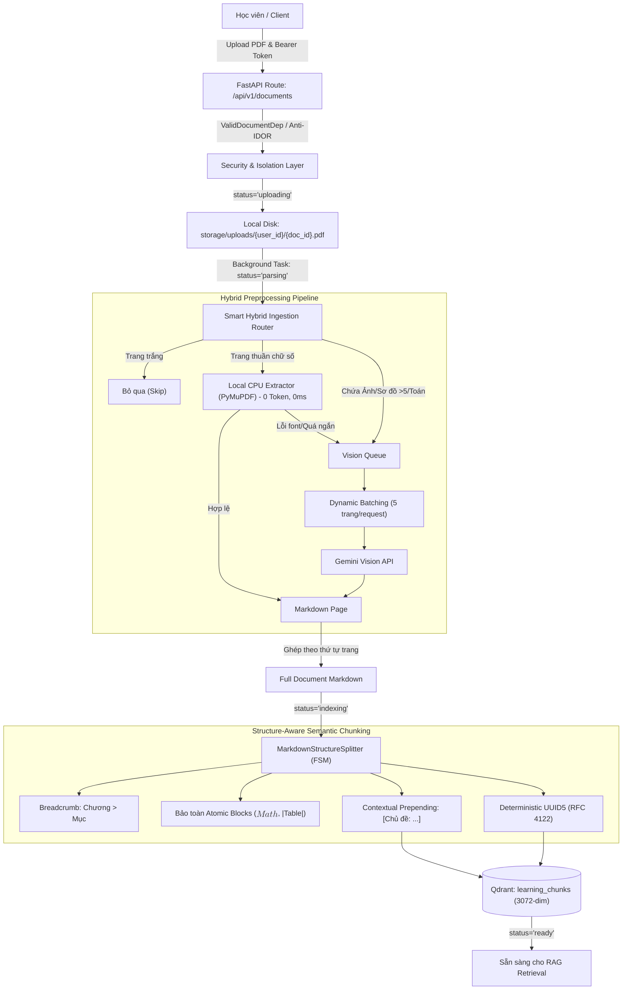

# Kiến Trúc Toàn Diện Module Documents & Pipeline Ingestion RAG

## 1. Tổng Quan & Vai Trò Hệ Thống (System Overview)
Module **Documents** (`apps/api/app/modules/documents`) là xương sống dữ liệu tri thức của nền tảng AI Learning Platform. Module này chịu trách nhiệm quản lý vòng đời tài liệu học tập của học viên: từ tải lên, phân quyền bảo mật, tiền xử lý và trích xuất nội dung đa phương thức (Multimodal/OCR), đến tách cấu trúc ngữ nghĩa (Semantic Chunking) và đánh chỉ mục vector vào Qdrant phục vụ AI Socratic Tutor, Bloom Quiz Generator và Flashcards.



---

## 2. Bảo Mật & Phân Quyền Đa Người Dùng (Multi-tenant Security & Anti-IDOR)

### 2.1. Kiểm soát truy cập chặt chẽ (FastAPI Dependency Guard)
- **Cơ chế**: Sử dụng dependency tập trung `ValidDocumentDep` cho mọi endpoint thao tác với tài liệu (`GET`, `DELETE`, `RETRY`, `PAGES`, `RETRIEVAL`).
- **Nguyên tắc chống rò rỉ (Enumeration Prevention)**:
  - Truy vấn luôn đi kèm điều kiện kép: `WHERE id = :document_id AND user_id = :current_user_id`.
  - Nếu tài liệu không tồn tại HOẶC thuộc quyền sở hữu của người dùng khác, hệ thống **luôn trả về mã lỗi `404 Not Found`** (thay vì `403 Forbidden`) để che giấu hoàn toàn sự tồn tại của tài liệu.
- **Phân tách vật lý trên ổ đĩa**:
  - File PDF tải lên: `storage/uploads/{user_id}/{document_id}.pdf`.
  - Dữ liệu bóc tách Markdown: `storage/parsed/{document_id}/pages/page_{page_num}.md`.

### 2.2. Cô lập dữ liệu Vector trên Qdrant (Metadata Pre-filtering)
- **Tập trung hóa Collection**: Toàn bộ hệ thống dùng chung collection `learning_chunks` để tối ưu RAM và tài nguyên kết nối.
- **Payload Index**: Đánh chỉ mục kiểu `KEYWORD` trên trường `user_id` và `doc_id`.
- **Bắt buộc tiền lọc (Pre-filter)**: Khi tìm kiếm vector phục vụ RAG chat, bộ lọc luôn tự động chèn bộ lọc metadata `user_id = current_user.id`, loại bỏ 100% nguy cơ rò rỉ dữ liệu chéo giữa các học viên.

### 2.3. Dọn dẹp tài nguyên 3 tầng (Cascade Clean-up)
Khi nhận yêu cầu `DELETE /api/v1/documents/{id}` hợp lệ từ chủ sở hữu:
1. Xóa toàn bộ vector points trong Qdrant có `doc_id == document_id`.
2. Xóa cascade bản ghi trong PostgreSQL (tự động dọn dẹp các session chat và bài kiểm tra liên quan).
3. Xóa toàn bộ file và thư mục vật lý trên đĩa (`storage/uploads/...` và `storage/parsed/...`).

---

## 3. Tiền Xử Lý Thông Minh: Smart Hybrid Ingestion Routing

Thay vì chuyển đổi toàn bộ 100% trang PDF thành hình ảnh PNG rồi gửi lên Vision API gây lãng phí từ 258 đến 1.000+ token/trang và nghẽn Rate Limit (429), hệ thống tích hợp bộ định tuyến hai nhánh:

### 3.1. Phân loại trang đa yếu tố (Multi-factor Inspection - `PageClassifier`)
Mỗi trang PDF được kiểm tra trong bộ nhớ trước khi xử lý:
* **Trang Rỗng (`PageRoute.EMPTY`)**: Không có chữ, không có ảnh, không có nét vẽ (`len(drawings) == 0`) -> Bỏ qua, tạo placeholder rỗng, không gọi API.
* **Trang Bắt buộc Vision (`PageRoute.VISION_REQUIRED`)**:
  - Có hình ảnh nhúng (`len(get_images()) > 0`).
  - Có vector vẽ kỹ thuật/sơ đồ phức tạp (`len(get_drawings()) > 5`).
  - Chứa ký hiệu toán học (`\int`, `\sum`, `\sqrt`, `\partial`, `\approx`, `\le`, `\ge`, `\times`) hoặc sử dụng font toán (`Math`, `CMSY`, `CMR`, `Symbol`, `CambriaMath`).
* **Trang Văn Bản Số Thuần (`PageRoute.LOCAL_TEXT`)**:
  - Không vi phạm các yếu tố trên và text dài $\ge 30$ ký tự (mục lục, tài liệu tham khảo, lời mở đầu, lý thuyết chữ).
  - Được xử lý hoàn toàn trên CPU máy chủ bằng PyMuPDF với **chi phí 0 token và độ trễ < 5ms**.

### 3.2. Chuẩn hóa Markdown cục bộ (`LocalTextExtractor`)
- **Tự động nhận diện Heading**: Dựa vào tỷ lệ font chữ so với font chữ nội dung phổ biến (`body_font_size`):
  - $\ge 1.35 \times \text{body\_size}$: Gán `# Tiêu đề`.
  - $\ge 1.18 \times \text{body\_size}$: Gán `## Tiêu đề con`.
  - $\ge 1.05 \times \text{body\_size}$ kèm cờ In đậm: Gán `### Tiêu đề cấp 3`.
- **Nối dòng thông minh (Unwrap Hard-wrapped Lines)**: Tự động ghép các dòng bị ngắt dòng giả tạo do layout PDF thành câu văn hoàn chỉnh; giữ nguyên thụt lề cho danh sách gạch đầu dòng (`•`, `-`, `*`, `1.`).
- **Cơ chế Safety Fallback**: Nếu text trích xuất cục bộ có độ dài $< 30$ ký tự hoặc chứa tỷ lệ ký tự rác/không in được $> 15\%$ (do PDF lỗi bảng mã font ToUnicode), hệ thống tự động đẩy trang đó sang Vision API để bảo toàn dữ liệu.

---

## 4. Xử Lý Bất Đồng Bộ & Dynamic Page Batching (Gemini Vision)

Đối với các trang bắt buộc dùng Vision OCR:
- **Đóng gói Batch Đa Trang (Dynamic Batching)**: Gom nhóm 5 trang ảnh PNG thành 1 lượt gọi API duy nhất tới Gemini Vision (`INGESTION_BATCH_SIZE = 5`). Giảm 80% số lượng request HTTP.
- **Ghép Prompt & Output có nhãn ranh giới**: Sử dụng định dạng phân cách tường minh `=== PAGE: {page_num} ===` trong prompt hướng dẫn mô hình OCR trả về kết quả từng trang rõ ràng.
- **Huỷ tác vụ lỗi nhanh qua `asyncio.TaskGroup` (Fail-fast)**: Khi có 1 batch gặp lỗi nghiêm trọng (đặc biệt là 429 Quota/Resource Exhausted), `TaskGroup` lập tức hủy toàn bộ các batch còn lại, ngăn chặn lãng phí tài nguyên.
- **Deterministic Merge**: Hợp nhất kết quả từ nhánh Local CPU và nhánh Gemini Vision theo đúng thứ tự chỉ số trang `page_number` tăng dần ($1 \to 2 \to 3 \dots$).

---

## 5. Tách Cấu Trúc Ngữ Nghĩa: Markdown Structure-Aware Semantic Chunking

Module `splitter.py` kế thừa lớp `MarkdownStructureSplitter` giải quyết triệt để nhược điểm của các thuật toán cắt chunk cơ học theo số token cố định:

### 5.1. Máy Trạng Thái Hữu Hạn (FSM - Finite State Machine)
FSM phân tích cú pháp Markdown và nhận diện 5 loại khối:
1. `HEADING`: Các dòng bắt đầu bằng `#`, `##`, `###`...
2. `MATH_BLOCK`: Các khối công thức toán nhiều dòng nằm giữa `$$...$$`.
3. `TABLE`: Toàn bộ các dòng bảng Markdown `|---|---|`.
4. `IMAGE`: Các khối mô tả hình ảnh `[Hình vẽ trang X: ...]`.
5. `PARAGRAPH`: Các đoạn văn xuôi thông thường.

### 5.2. Nguyên tắc Bất biến khi Chunking:
- **Khối Nguyên Tử (Atomic Blocks)**: Khối toán LaTeX và bảng dữ liệu **tuyệt đối không bao giờ bị cắt rời**. Nếu kích thước khối vượt quá `chunk_size` (768 tokens), khối đó được giữ nguyên vẹn trong một chunk độc lập.
- **Cây phân cấp Tiêu đề (Heading Hierarchy Tracking)**: Tự động ghi nhớ tiêu đề cấp 1, cấp 2, cấp 3 hiện tại để tạo chuỗi breadcrumb: `Chương 1 > Mục 1.2 Kiến trúc`.
- **Contextual Prepending**: Tự động chèn tiền tố ngữ cảnh vào đầu mỗi chunk:
  ```markdown
  [Chủ đề: Giáo Trình Nhập Môn RAG > Chương 1: Kiến Trúc > Mục 1.2 Semantic Chunking]

  Nội dung đoạn văn hoặc công thức toán học...
  ```
- **Deterministic UUID5**: Mỗi chunk được gán ID tất định chuẩn RFC 4122:
  ```python
  chunk_id = str(uuid.uuid5(uuid.NAMESPACE_DNS, f"{doc_id}_page_{page_number}_chunk_{chunk_idx}"))
  ```
  Tương thích 100% với định dạng point ID của Qdrant.

---

## 6. Lưu Trữ & Truy Vấn Vector (Qdrant Vector Database)

### 6.1. Cấu hình Collection `learning_chunks`
- **Số chiều (Dimensions)**: 3072 chiều (mô hình `gemini-embedding-001`).
- **Độ đo khoảng cách**: `Cosine`.
- **Payload Schema**:
  - `doc_id` (`KEYWORD`): Định danh tài liệu.
  - `page_number` (`INTEGER`): Trang tài liệu.
  - `user_id` (`KEYWORD`): Chủ sở hữu tài liệu (phục vụ Anti-IDOR pre-filtering).
  - `section_heading` (`KEYWORD`): Tiêu đề phân mục.
  - `has_formula` (`BOOL`): Đánh dấu chunk có chứa công thức toán.
  - `has_image` (`BOOL`): Đánh dấu chunk có hình vẽ.

### 6.2. Vòng đời trạng thái tài liệu (Status Flow)
Trạng thái của tài liệu được đồng bộ liên tục giữa Postgres DB và metadata file:
```
[uploading] ──> [parsing] ──> [indexing] ──> [ready]
     │              │              │
     └──(lỗi)───────┴──(lỗi)───────┴──(lỗi)──> [failed] (Lưu localized error_message)
```

### 6.3. Tối Ưu Hóa Embedding Cho Tài Liệu Lớn (Adaptive Batching & 429 Backoff)
Đối với các tài liệu dài từ 50 đến 200+ trang (sinh ra 300 – 1.000+ chunks), việc gửi toàn bộ chunks sang Embedding API dễ chạm trần **15 RPM (Requests Per Minute)** của Google Gemini:
1. **Nâng kích thước Embedding Batch (`EMBEDDING_BATCH_SIZE = 50`)**: Thay vì dùng mức mặc định 10 của LlamaIndex, cấu hình nâng lên 50 chunks/lượt để tận dụng năng lực xử lý mảng `batchEmbedContents` của Google, giảm 80% số lượng request API.
2. **Kiểm soát nhịp độ phát tán (`EMBEDDING_BATCH_DELAY_SECONDS = 1.0`)**: Chèn khoảng nghỉ chủ động giữa các batch để tốc độ gửi request luôn duy trì an toàn dưới 15 RPM.
3. **Cơ chế Tự phục hồi lỗi hạn ngạch (429 Exponential Backoff)**: Tích hợp vòng lặp retry chuyên biệt với thời gian lùi lũy thừa ($4\text{s} \to 8\text{s} \to 16\text{s} \to 32\text{s}$) khi gặp mã lỗi `429 / Resource Exhausted`, bảo đảm tài liệu 83 - 200+ trang nạp thành công 100% mà không bị đứt gãy giữa chừng.

---

## 7. Cấu Trúc Mã Nguồn & Bản Đồ Thư Mục

| File | Trách nhiệm chính |
|---|---|
| `service.py` | Điều phối luồng Ingestion Worker, quản lý tác vụ nền và trạng thái tài liệu. |
| `storage.py` | Quản lý lưu trữ tệp, đường dẫn đĩa vật lý, `metadata.json`, đếm trang parsed thời gian thực. |
| `errors.py` | Chuẩn hóa thông báo lỗi tiếng Việt thân thiện người dùng theo từng giai đoạn pipeline. |
| `hybrid_router.py` | Phân loại trang (Multi-factor Inspection) và trích xuất text CPU Heuristic. |
| `renderer.py` | Render trang PDF thành PNG bytes 150 DPI bằng PyMuPDF. |
| `vision_parser.py` | Gọi Gemini Vision API theo batch 5 trang, xử lý lỗi và rate-limit. |
| `splitter.py` | FSM Semantic Splitter, bảo toàn khối công thức toán, bảng và thêm contextual breadcrumb. |
| `vector_service.py` | Tích hợp LlamaIndex và Qdrant collection `learning_chunks`, quản lý points vector. |
| `router.py` | REST API endpoints, kiểm soát phân quyền (`ValidDocumentDep`), xử lý upload, retry, delete. |
| `dependencies.py` | FastAPI dependencies kiểm tra quyền sở hữu tài liệu chống lỗ hổng IDOR. |
| `schemas.py` | Pydantic DTO schemas cho API request/response và metadata. |
| `models.py` | SQLAlchemy DB models: `Document`, `Subject`... |

---

## 8. Chiến Lược Kiểm Thử (Testing & Quality Assurance)
Hệ thống được bảo vệ bởi bộ test tự động toàn diện:
- `test_document_auth_idor.py`: Kiểm thử phân quyền truy cập, chống IDOR và cô lập tìm kiếm vector giữa các người dùng.
- `test_document_storage.py`: Kiểm thử tầng lưu trữ tệp, metadata persistence và đếm số trang thời gian thực.
- `test_hybrid_router.py`: Kiểm thử bộ phân loại trang, trích xuất text CPU, fallback an toàn và ghép thứ tự trang tất định.
- `test_splitter.py`: Kiểm thử FSM phân tích khối, bảo toàn toán/bảng, phân cấp tiêu đề và contextual prefix prepending.
- `test_vision_parser.py`: Kiểm thử cơ chế batching 5 trang và TaskGroup cancel khi gặp lỗi 429 quota.
- `test_vector_service.py`: Kiểm thử embedding adaptive batching, 429 backoff retry và metadata filtering trên Qdrant.
- `test_document_endpoints.py`: Kiểm thử các endpoint upload, content, pages, retry và delete.
