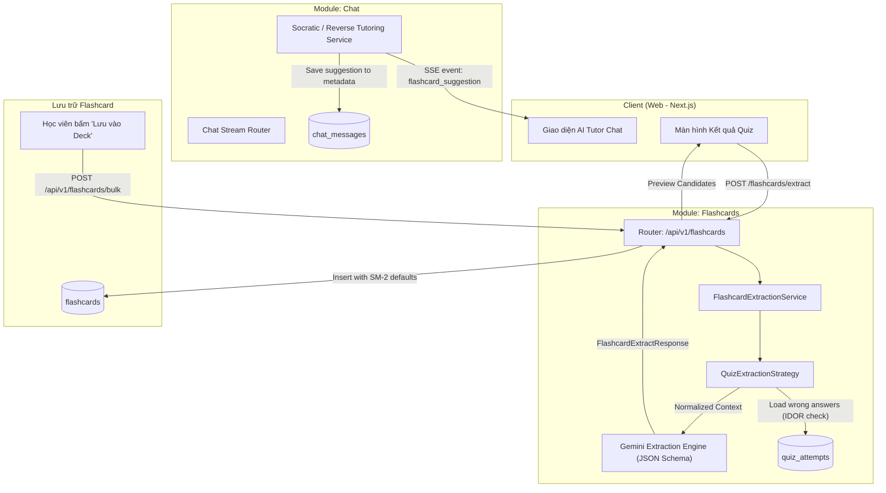

# Thiết Kế Kỹ Thuật: Hệ Thống Trích Xuất Tự Động Flashcard (Chat & Quiz)

Tài liệu này xác định kiến trúc, lược đồ dữ liệu và luồng xử lý chi tiết cho tính năng trích xuất cặp Flashcard (Thuật ngữ - Định nghĩa / Công thức - Khái niệm) từ hai nguồn: tương tác phản hồi với AI Tutor (Real-time Inline Suggestion) và các câu làm sai sau khi hoàn thành bài Quiz (Post-attempt Batch Extraction).

---

## 1. Tóm Tắt Hiểu Biết & Bối Cảnh (Understanding Summary)

* **Mục tiêu:** Cung cấp cơ chế tự động hoá việc tạo Flashcard chất lượng cao nhằm biến các lỗi sai và hiểu lầm của học viên thành cơ hội ghi nhớ sâu sắc (active recall & spaced repetition).
* **Nguồn dữ liệu:**
  1. **AI Tutor Chat:** Phát hiện tức thì (real-time) khi học viên có ngộ nhận hoặc trả lời sai trong mạch đối thoại, đính kèm gợi ý tạo thẻ trực tiếp dưới tin nhắn AI.
  2. **Quiz Attempt:** Thu thập toàn bộ các câu hỏi học viên trả lời sai sau khi nộp bài thi để LLM cô đọng thành các cặp thẻ củng cố kiến thức.
* **Luồng người dùng (User Flow):** 
  * Cả hai luồng đều hoạt động theo nguyên tắc **Preview before Save**: Hệ thống đề xuất thẻ, học viên xem lại/chỉnh sửa nội dung trước khi chọn Deck để lưu trữ.
* **Phi mục tiêu (Explicit Non-Goals):**
  * Không tự động ghi ngầm thẻ vào CSDL mà chưa qua sự xác nhận của người dùng.
  * Không thay đổi thuật toán Spaced Repetition (SM-2) sẵn có.
  * Không quét toàn bộ lịch sử dài của chat nếu không cần thiết; ưu tiên phản hồi tức thì tại lượt hội thoại có lỗi.

---

## 2. Giả Định Kỹ Thuật (Assumptions)

1. **Bảo mật & Phân quyền (IDOR Defense):** Người dùng chỉ được phép trích xuất hoặc nhận gợi ý từ các phiên chat và bài quiz do chính họ sở hữu (`user_id == current_user.id`).
2. **Quy mô dữ liệu & Giới hạn tải:**
   * Đối với Quiz: Trích xuất tối đa **10 câu sai trọng tâm nhất** trong một lần nộp bài để đảm bảo thời gian phản hồi của LLM trong khoảng 5–15 giây.
   * Nếu bài thi đạt điểm tuyệt đối (0 câu sai): Trả về danh sách rỗng ngay lập tức mà không gọi LLM.
3. **Mô hình LLM:** Sử dụng Google GenAI Client (`gemini-3.1-flash-lite `) thông qua `GenerateContentConfig(response_mime_type="application/json", response_schema=...)` để đảm bảo 100% tuân thủ cấu trúc Pydantic.

---

## 3. Nhật Ký Quyết Định (Decision Log)

| Quyết định | Các phương án đã cân nhắc | Lý do lựa chọn |
| :--- | :--- | :--- |
| **Cơ chế Chat AI Tutor** | **Inline Suggestion Real-time** vs Quét hàng loạt cuối phiên | Tạo vòng phản hồi tức thì (Instant Feedback Loop). Học viên nhận thấy ngay lỗ hổng kiến thức tại thời điểm phát sinh ngộ nhận. |
| **Cơ chế Quiz** | **Batch Extraction sau khi nộp bài** vs Tạo thẻ tức thì khi làm từng câu | Giữ sự liền mạch cho kỳ thi/bài kiểm tra; gom các câu sai gọi LLM 1 lần duy nhất giúp tiết kiệm chi phí token và tối ưu trải nghiệm tổng kết. |
| **Kiến trúc Endpoint** | **Strategy Pattern** (`/flashcards/extract`) vs Endpoint phân tán từng module | Tập trung nghiệp vụ flashcard, tách bạch logic truy vấn nguồn và logic sinh thẻ của LLM, dễ mở rộng thêm nguồn tài liệu hay video sau này. |
| **Định dạng dữ liệu** | **Structured Output (JSON/Pydantic)** vs Raw text regex parsing | An toàn kiểu dữ liệu, loại bỏ lỗi parsing cú pháp, hỗ trợ định dạng Markdown và công thức LaTeX toán học chuẩn. |

---

## 4. Kiến Trúc Hệ Thống (Architecture & Components)



---

## 5. DTO & API Schemas

### 5.1. Trích xuất Flashcard từ Quiz (Batch Endpoint)

* **Endpoint:** `POST /api/v1/flashcards/extract`
* **Request Payload (`FlashcardExtractRequest`):**
```python
from enum import Enum
import uuid
from pydantic import BaseModel, Field

class ExtractionSourceType(str, Enum):
    QUIZ_ATTEMPT = "quiz_attempt"
    CHAT_SESSION = "chat_session"

class FlashcardExtractRequest(BaseModel):
    source_type: ExtractionSourceType = Field(..., description="Loại nguồn trích xuất")
    source_id: uuid.UUID = Field(..., description="ID của lượt làm quiz hoặc phiên chat")
    message_ids: list[uuid.UUID] | None = Field(default=None, description="Danh sách tin nhắn chỉ định (nếu từ chat)")
```

* **Candidate Item Schema (`ExtractedFlashcardItem`):**
```python
from typing import Literal

class ExtractedFlashcardItem(BaseModel):
    front_text: str = Field(..., description="Mặt trước: Thuật ngữ, câu hỏi khái niệm hoặc tên công thức (Markdown/LaTeX)")
    back_text: str = Field(..., description="Mặt sau: Định nghĩa, bản chất, công thức chuẩn và lưu ý cốt lõi")
    category: Literal["term", "concept", "formula"] = Field(..., description="Phân loại thẻ")
    context_snippet: str | None = Field(default=None, description="Đoạn trích dẫn gốc ngắn giúp gợi nhớ ngữ cảnh")
    trigger_reason: str | None = Field(default=None, description="Lý do tạo: lỗi sai hoặc ngộ nhận cần củng cố")
```

* **Response Payload (`FlashcardExtractResponse`):**
```python
class FlashcardExtractResponse(BaseModel):
    source_type: ExtractionSourceType
    source_id: uuid.UUID
    cards: list[ExtractedFlashcardItem]
    total_extracted: int
    message: str | None = None
```

### 5.2. Sự kiện Real-time trong Chat Stream (SSE Payload)

Khi AI Tutor phát hiện người học hiểu sai trong lượt chat, luồng SSE sẽ bắn event:
```
event: flashcard_suggestion
data: {
  "front_text": "Định luật II Newton",
  "back_text": "$\\vec{F} = m\\vec{a}$. Gia tốc tỷ lệ thuận với lực tác dụng và tỷ lệ nghịch với khối lượng của vật.",
  "category": "formula",
  "trigger_reason": "Học sinh hiểu nhầm lực là nguyên nhân duy trì vận tốc thay vì gây ra gia tốc."
}
```
Event này đồng thời được lưu vào cột `metadata` của `ChatMessage` tương ứng dưới cấu trúc:
```json
{
  "flashcard_suggestion": {
    "front_text": "...",
    "back_text": "...",
    "category": "formula",
    "trigger_reason": "..."
  }
}
```

### 5.3. Lưu trữ thẻ hàng loạt (Bulk Create)

* **Endpoint:** `POST /api/v1/flashcards/bulk`
* **Request Payload (`FlashcardBulkCreateRequest`):**
```python
class FlashcardItemCreate(BaseModel):
    front_text: str
    back_text: str
    page_number: int | None = None

class FlashcardBulkCreateRequest(BaseModel):
    deck_id: uuid.UUID
    cards: list[FlashcardItemCreate]
```

---

## 6. Xử Lý Ngoại Lệ & Trường Hợp Biên (Edge Cases)

1. **Quiz không có câu sai:**
   * Nếu `len(wrong_answers) == 0`: Trả về `total_extracted: 0, cards: []` kèm thông báo khen ngợi. Tuyệt đối không gọi Gemini LLM.
2. **Quiz chưa hoàn tất (`status != "completed"`):**
   * Bắn lỗi `400 Bad Request` với message: `"Vui lòng nộp bài thi trước khi trích xuất flashcard ôn tập."`
3. **Phân quyền truy cập (IDOR Defense):**
   * Nếu `attempt.user_id != current_user.id` hoặc `session.user_id != current_user.id`, ném `404 Not Found` (tránh rò rỉ ID sang người dùng khác).
4. **Vượt ngưỡng token (Quá nhiều câu sai):**
   * Giới hạn tối đa 10 câu sai quan trọng nhất đưa vào prompt.
5. **Mất kết nối mạng giữa chừng:**
   * Với Chat: Gợi ý đã được lưu vào database (`ChatMessage.metadata`), người dùng tải lại trang vẫn xem và lưu được thẻ.

---

## 7. Chiến Lược Kiểm Thử (Testing Strategy)

### 7.1. Unit Tests
* `test_quiz_extraction_no_wrong_answers`: Kiểm tra trường hợp 0 câu sai trả về mảng rỗng, LLM Client không bị kích hoạt.
* `test_quiz_extraction_filters_wrong_only`: Kiểm tra ngữ cảnh gửi sang prompt chỉ chứa các câu trả lời sai.
* `test_quiz_extraction_caps_at_10_items`: Kiểm tra hàm cắt gọn danh sách khi có hơn 10 câu sai.
* `test_chat_misconception_metadata_persistence`: Đảm bảo metadata chứa `flashcard_suggestion` được lưu chính xác vào DB.

### 7.2. Integration Tests
* `test_extract_flashcards_idor_forbidden`: Học viên A gọi trích xuất bài thi của Học viên B -> Trả về `404 Not Found`.
* `test_extract_flashcards_incomplete_quiz`: Trích xuất bài thi chưa nộp -> Trả về `400 Bad Request`.
* `test_extract_flashcards_quiz_success`: Mock Gemini Structured Output -> Kiểm tra cấu trúc `FlashcardExtractResponse` khớp với DTO.
* `test_bulk_save_flashcards`: Kiểm tra lưu danh sách thẻ vào `flashcards` với các giá trị mặc định SM-2 (`easiness_factor = 2.5`, `interval_days = 0`, `repetition_number = 0`).
