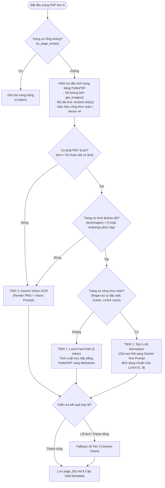

# THIẾT KẾ GIẢI PHÁP TỐI ƯU HÓA TOKEN PIPELINE INGESTION (HYBRID 3-TIER ROUTER)
## DỰ ÁN: AI LEARNING PLATFORM (LMS)

---

| **Thông tin tài liệu** | **Chi tiết** |
| :--- | :--- |
| **Tên tài liệu** | Thiết kế Kỹ thuật: Bộ định tuyến bóc tách tài liệu đa tầng (Hybrid 3-Tier Ingestion Router) |
| **Mục đích** | Tối ưu hóa chi phí và lượng token tiêu thụ của Gemini API trong giai đoạn bóc tách PDF |
| **Trạng thái** | Thiết kế hoàn chỉnh (Sẵn sàng triển khai khi có nhu cầu nâng cấp) |
| **Vị trí lưu trữ** | `docs/INGESTION_TOKEN_OPTIMIZATION.md` |
| **Tác giả** | Long (AI Lead) |
| **Ngày tạo** | 2026-10-20 |
| **Nâng cấp** | Chưa cần |

---

## 1. TỔNG QUAN & BỐI CẢNH (UNDERSTANDING SUMMARY)

### 1.1. Vấn đề thực tế (Problem Statement)
Trong triển khai hiện tại của Ingestion Worker (`app/modules/documents/service.py`):
- Mọi trang PDF không rỗng (`total_pages`) đều được kết xuất thành hình ảnh PNG (150 DPI) và gửi trực tiếp sang **Gemini 1.5 Flash Vision** (`gemini-3.5-flash-lite`).
- Đối với tài liệu giáo trình dài (50–200 trang):
  - Rất nhiều trang chỉ chứa văn bản kỹ thuật số đơn thuần (Digital Text) hoặc trang mục lục, tài liệu tham khảo.
  - Mỗi bức ảnh PNG nạp vào Vision API tiêu tốn trung bình từ **258 đến 1.000+ Vision Tokens/trang** (tùy độ phân giải) và dễ chạm ngưỡng giới hạn tần suất (Rate Limit 429/Resource Exhausted).
  - Chi phí token tăng tuyến tính theo số trang, gây lãng phí lớn đối với tài liệu học thuật nhiều chữ.

### 1.2. Mục tiêu giải pháp (Goals)
1. **Giảm 60% – 80% lượng token tiêu thụ** cho mỗi tài liệu PDF được bóc tách.
2. **Duy trì 100% độ chính xác nguyên văn (High Fidelity):**
   - Công thức toán học nội dòng và dạng khối bắt buộc chuẩn hóa LaTeX (`$...$` và `$$...$$`).
   - Sơ đồ, hình vẽ kỹ thuật vẫn có mô tả caption đầy đủ `[Hình vẽ trang X: ...]`.
3. **Cơ chế suy thoái mềm (Graceful Fallback):** Nếu bóc tách cục bộ không khả thi hoặc gặp lỗi font, hệ thống tự động fallback về Gemini Vision an toàn.

### 1.3. Phạm vi ngoài lề (Explicit Non-goals)
- Không cài đặt các thư viện OCR cục bộ nặng nề (như Tesseract, PaddleOCR) gây cồng kềnh cho Docker container.
- Không thay đổi cấu trúc lưu trữ và schema dữ liệu đầu ra: Tài liệu sau bóc tách vẫn là các file Markdown chuẩn KaTeX (`page_{X}.md` và `full_document.md`).
- Chưa can thiệp vào tầng truy vấn RAG / Vector Search trong tài liệu này (chuyên biệt cho Ingestion).

---

## 2. NHẬT KÝ QUYẾT ĐỊNH THIẾT KẾ (DECISION LOG)

| STT | Quyết định | Các phương án đã cân nhắc | Lý do lựa chọn |
| :--- | :--- | :--- | :--- |
| **D-01** | **Mô hình Hybrid 3 tầng** thay vì Vision toàn bộ | - Phương án 1: Tiếp tục gửi Vision 100% trang.<br>- Phương án 2: Chỉ bóc tách PyMuPDF thô.<br>- **Phương án 3: Phân tầng 3 cấp (Chọn).** | Cân bằng hoàn hảo giữa tiết kiệm token (trang text thường tốn 0 token) và độ chính xác công thức/hình vẽ. |
| **D-02** | **Dùng Text LLM chuẩn hóa công thức** cho trang có toán nhưng không có ảnh | - Phương án 1: Bắt buộc gửi Vision nếu có toán.<br>- **Phương án 2: Gửi Text thô sang Text Prompt (Chọn).** | Text prompt rẻ hơn Vision Prompt từ 4 đến 5 lần và nhanh hơn gấp 3 lần vì không phải mã hóa và truyền tải ảnh PNG. |
| **D-03** | **Theo dõi token tối giản ở cấp tài liệu** | - Phương án 1: Lưu token chi tiết từng trang vào `metadata.json`.<br>- **Phương án 2: Tổng hợp cấp tài liệu trong `token_usage_logs` (Chọn).** | Giảm thiểu overhead I/O đĩa, giữ `metadata.json` gọn nhẹ, đáp ứng đúng yêu cầu quản trị. |

---

## 3. KIẾN TRÚC KỸ THUẬT CHI TIẾT (TECHNICAL ARCHITECTURE)

### 3.1. Sơ đồ luồng xử lý trang (3-Tier Router Flowchart)



---

### 3.2. Chi tiết 3 Tầng Xử lý (The 3 Tiers)

#### 🟢 TẦNG 1: Local Fast-Path (Chi phí: 0 Token | Độ trễ: < 10ms)
- **Điều kiện kích hoạt:**
  - `len(images) == 0` (không có ảnh bitmap).
  - `len(drawings) < 5` (không có sơ đồ vector hoặc đồ thị).
  - Không phát hiện ký hiệu toán học đặc thù qua bộ lọc Regex.
  - Text trích xuất được có độ dài có nghĩa (`len(text) >= 50`).
- **Cách xử lý:**
  - Dùng PyMuPDF `page.get_text("blocks")` để giữ thứ tự các khối đoạn văn bản, tiêu đề.
  - Định dạng chuyển đổi nhanh sang Markdown thô.
- **Tiêu thụ token:** **0 token**.

#### 🟡 TẦNG 2: Text LLM Normalizer (Chi phí: ~300 - 800 Text Tokens | Độ trễ: ~1s)
- **Điều kiện kích hoạt:**
  - Trang có lớp text kỹ thuật số rõ ràng (`len(text) >= 50`).
  - Trang **không có hình ảnh/sơ đồ** (`len(images) == 0`).
  - Trang **có chứa biểu thức toán học** (ví dụ: các hàm $\sin, \cos, \log$, ký hiệu $\sum, \int, \frac{a}{b}$, ma trận, ký tự Hy Lạp $\alpha, \beta, \theta$ hoặc số mũ/chỉ số dưới).
- **Cách xử lý:**
  - Lấy text thô bóc tách từ PyMuPDF.
  - Gọi Gemini Flash bằng **Text-only prompt** (không đính kèm hình ảnh):
    > *"Bạn là chuyên gia số hóa văn bản. Hãy chuẩn hóa các công thức toán học trong đoạn văn bản sau sang cú pháp LaTeX chuẩn (`$...$` cho inline và `$$...$$` cho block). Giữ nguyên toàn bộ nội dung chữ khác."*
- **Ưu điểm:** Tiết kiệm khoảng 70% so với việc truyền cả bức ảnh PNG vào Vision API.

#### 🔴 TẦNG 3: Gemini Vision OCR (Chi phí: ~800 - 1.200 Vision Tokens | Độ trễ: ~2.5s)
- **Điều kiện kích hoạt:**
  - Trang là PDF Scan (ảnh chụp tài liệu, không có text layer số).
  - Trang chứa hình vẽ, đồ thị, sơ đồ kỹ thuật (`len(images) > 0` hoặc vector nét vẽ lớn).
  - Trang mà Tầng 1 hoặc Tầng 2 bị lỗi trích xuất ký tự (font ligatures, mã hóa lạ).
- **Cách xử lý:**
  - Render trang thành ảnh PNG 150 DPI trong RAM.
  - Gọi Gemini Vision với Prompt OCR chuyên sâu hiện tại (sinh caption `[Hình vẽ trang X: ...]` và KaTeX).

---

### 3.3. Bộ quy tắc nhận diện toán học cục bộ (Math Heuristic Regex)

Để phân biệt giữa Tầng 1 (văn bản thuần) và Tầng 2 (văn bản có toán) mà không tốn token LLM, bộ lọc sử dụng Regex đối soát nhanh:

```python
MATH_SYMBOLS_REGEX = re.compile(
    r"["
    r"\u2200-\u22FF"  # Mathematical Operators (∀, ∃, ∅, ∇, ∈, ∉, ∏, ∑, ∫, √, ∝, ∞, ∠, ∧, ∨, ∩, ∪...)
    r"\u2A00-\u2AFF"  # Supplemental Mathematical Operators
    r"\u2100-\u214F"  # Letterlike Symbols (ℂ, ℝ, ℤ, ℵ, ℏ...)
    r"\u0370-\u03FF"  # Greek Letters (α, β, γ, δ, ε, θ, λ, μ, π, σ, ω, Δ, Ω...)
    r"\u2070-\u209F"  # Superscripts and Subscripts (x², y³, a₁, bₙ...)
    r"]|"
    r"(?:\b(?:lim|sin|cos|tan|cot|log|ln|det|gcd|deg)\b\s*[\(_\^0-9a-zA-Z\\])|"
    r"(?:[\w\)]+\s*[\^=<>±×÷]\s*[\w\(]+)"
)
```

---

## 4. KẾ HOẠCH TRIỂN KHAI NÂNG CẤP (IMPLEMENTATION PLAN)

Khi bạn quyết định nâng cấp pipeline Ingestion, các bước triển khai sẽ bao gồm:

### Bước 1: Tạo Module Router phân loại trang
- **Tập tin mới:** `app/modules/documents/page_classifier.py`
- **Nhiệm vụ:**
  - Hàm `inspect_page(doc, page_num) -> PageClassification`:
    - Đếm text length, image count, drawing count.
    - Chạy `MATH_SYMBOLS_REGEX`.
    - Trả về nhãn: `TIER_1_LOCAL_TEXT`, `TIER_2_TEXT_LLM`, `TIER_3_VISION`.

### Bước 2: Bổ sung Text Normalizer vào `vision_parser.py`
- **Tập tin sửa đổi:** `app/modules/documents/vision_parser.py`
- **Nhiệm vụ:**
  - Thêm phương thức `normalize_math_text(raw_text: str, page_number: int) -> tuple[str, ParsedPageMetadata]`.
  - Chỉ gọi `client.aio.models.generate_content` với string prompt, không gửi image bytes.

### Bước 3: Cập nhật Service Pipeline
- **Tập tin sửa đổi:** `app/modules/documents/service.py`
- **Nhiệm vụ:**
  - Cập nhật hàm `_process_single_page`:
    1. Kiểm tra rỗng $\rightarrow$ Skip.
    2. Gọi `page_classifier`.
    3. Route tương ứng tới `local_extractor`, `normalize_math_text`, hoặc `parse_page_image`.
    4. Bọc Try-Except để tự động fallback về `parse_page_image` nếu Tier 1/2 phát sinh ngoại lệ.

### Bước 4: Viết Unit Test & Benchmark
- **Tập tin mới:** `tests/test_hybrid_ingestion.py`
- Kiểm thử các trường hợp:
  - Trang văn bản thuần (đảm bảo không gọi Gemini API).
  - Trang có công thức toán (gọi Text Normalizer).
  - Trang có hình vẽ (gọi Vision OCR).
  - Fallback an toàn khi text lỗi.

---

## 5. ƯỚC TÍNH HIỆU QUẢ TIẾT KIỆM (COST & TOKEN BENCHMARK)

Giả định một tài liệu giáo trình kỹ thuật dài **100 trang** gồm:
- 50 trang lý thuyết chữ thuần túy (Mục lục, giới thiệu, khái niệm, lịch sử).
- 35 trang chứa công thức toán học nội dòng/khối, không có đồ thị.
- 15 trang chứa sơ đồ mạch điện, biểu đồ số liệu hoặc trang scan.

| Thành phần | Pipeline Hiện Tại (100% Vision) | Pipeline Mới (Hybrid 3-Tier) | Tiết kiệm (%) |
| :--- | :--- | :--- | :--- |
| **50 trang text thuần** | 50 trang × 800 tokens = **40.000 tokens** | 50 trang × 0 tokens = **0 tokens** | **Giảm 100%** |
| **35 trang toán không ảnh** | 35 trang × 800 tokens = **28.000 tokens** | 35 trang × 350 tokens = **12.250 tokens** | **Giảm ~56%** |
| **15 trang có ảnh / scan** | 15 trang × 800 tokens = **12.000 tokens** | 15 trang × 800 tokens = **12.000 tokens** | Giữ nguyên chất lượng |
| **TỔNG CỘNG** | **80.000 tokens** | **24.250 tokens** | **TIẾT KIỆM ~70% TỔNG TOKEN** |
| **Thời gian bóc tách** | ~90 - 120 giây (bị bottleneck 429) | ~25 - 35 giây (Fast-path chạy song song tức thì) | **Nhanh hơn ~3.5 lần** |

---

## 6. KẾT LUẬN & TRẠNG THÁI BÀN GIAO
Tài liệu này đã chốt đầy đủ cấu trúc thiết kế, logic phân luồng, thuật toán nhận diện và kế hoạch mã hóa. Bất cứ khi nào bạn muốn tiến hành triển khai vào codebase, chỉ cần kích hoạt tài liệu này để tiến hành theo 4 bước đã vạch sẵn.
