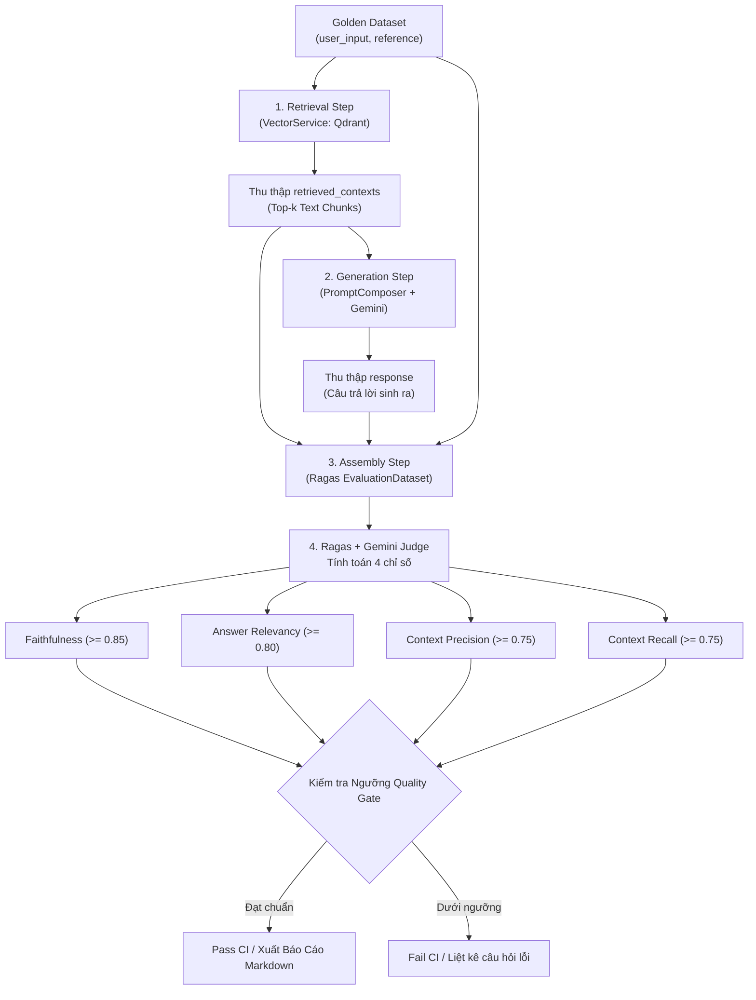

# RAG Evaluation Framework Specification & Architecture Design

Tài liệu thiết kế kỹ thuật hoàn chỉnh cho hệ thống đánh giá chất lượng RAG (Offline Benchmark & CI/CD Quality Gate) thuộc dự án AI-Powered Personalized Learning Platform.

---

## 1. Tóm Tắt Mục Tiêu & Yêu Cầu (Understanding Summary)

* **Hệ thống được xây dựng:** Hệ thống đánh giá chất lượng RAG (RAG Evaluation Framework) theo mô hình **Offline Benchmark & CI/CD Pipeline**, tích hợp trực tiếp thư viện **Ragas** và mô hình **Google Gemini** làm Judge LLM.
* **Mục đích:** Định lượng chính xác năng lực tìm kiếm đoạn trích (Retrieval) và độ trung thực của câu trả lời sinh ra (Generation), ngăn ngừa suy giảm chất lượng kiến thức khi cập nhật prompt, embedding hoặc chiến lược chunking.
* **Đối tượng phục vụ:** AI Engineers, Backend Developers và CI/CD automated test runner.
* **Bộ chỉ số đo lường trọng tâm (RAG Triad):**
  1. **Faithfulness:** Kiểm tra từng phát biểu trong câu trả lời có được bảo chứng bởi ngữ cảnh tìm thấy hay không (chống ảo giác / hallucination).
  2. **Answer Relevancy:** Đánh giá mức độ câu trả lời đi thẳng vào trọng tâm câu hỏi của người học.
  3. **Context Precision:** Đo lường tỷ lệ các đoạn trích liên quan cao xuất hiện ở vị trí đầu của kết quả tìm kiếm.
  4. **Context Recall:** Kiểm tra các đoạn trích thu thập được có bao phủ đầy đủ thông tin để trả lời đáp án chuẩn hay không.
* **Chiến lược dữ liệu (Hybrid Testset):** Cung cấp công cụ sinh dữ liệu tự động (Synthetic Dataset Generator) từ tài liệu học tập, kết hợp quản lý bộ câu hỏi chuẩn hóa có thẩm định của con người (`golden_dataset.json`).
* **Ranh giới (Non-Goals):**
  * Không phát triển UI/Web Dashboard riêng cho end-user ở giai đoạn này.
  * Chưa triển khai Online Realtime Evaluation trên từng query người dùng thật trên production.
  * Không sử dụng thêm các LLM tính phí ngoài Google Gemini.

---

## 2. Các Giả Định Kỹ Thuật & Quản Trị Rủi Ro (Assumptions & Risks)

### Giả Định Kỹ Thuật (Assumptions)
1. **Toolchain & Dependencies:** Toàn bộ công cụ và thư viện (`ragas`, `pandas`, `pytest`) được quản lý bằng `uv` trong nhóm `dev` của `apps/api/pyproject.toml`.
2. **LLM Provider:** Sử dụng `GEMINI_API_KEY` hiện có. Quá trình chấm điểm được thực hiện thông qua Gemini 1.5/2.5 Pro hoặc Flash làm LLM Judge.
3. **Quy mô bộ test CI/CD:** Bộ `golden_dataset.json` dùng cho kiểm thử tự động trên CI/CD có kích thước từ **20 – 50 câu hỏi** nhằm đảm bảo thời gian chạy dưới 3–5 phút.

### Quản Trị Rủi Ro (Risks & Mitigations)
* **Rủi ro Rate Limit (HTTP 429 Too Many Requests):**
  * *Biện pháp:* Khống chế số lượng request song song (Semaphore giới hạn tối đa 3-5 concurrent workers) và áp dụng cơ chế **Exponential Backoff with Jitter** retry tối đa 4 lần.
* **Rủi ro mất kết quả khi benchmark dài:**
  * *Biện pháp:* Triển khai cơ chế **Checkpointing** lưu tạm kết quả từng câu vào file cache `.eval_cache.json` để có thể tiếp tục (resume) mà không cần chạy lại từ đầu.
* **Trường hợp không tìm thấy ngữ cảnh (Zero Contexts):**
  * *Biện pháp:* Khi Qdrant trả về danh sách rỗng, gán `retrieved_contexts = [""]`, ghi nhận `context_recall = 0.0` và `context_precision = 0.0` để tiếp tục pipeline một cách an toàn.

---

## 3. Nhật Ký Quyết Định (Decision Log)

| ID | Vấn Đề Quyết Định | Lựa Chọn Được Chọn | Các Phương Án Đã Cân Nhắc | Lý Do Lựa Chọn |
| :--- | :--- | :--- | :--- | :--- |
| **DEC-01** | Phạm vi hệ thống | Offline Benchmark & CI/CD Gate | Online Realtime Monitoring, Cả hai cùng lúc | Tối ưu chi phí API, kiểm soát chất lượng hồi quy trực tiếp trước khi code được merge lên production. |
| **DEC-02** | Thư viện & Judge LLM | Ragas + Google Gemini | DeepEval, LlamaIndex Native Evals, OpenAI GPT-4o | Ragas là chuẩn công nghiệp phổ biến nhất; tận dụng Gemini API key sẵn có giúp đồng bộ hạ tầng và không phát sinh thêm chi phí. |
| **DEC-03** | Kiến trúc triển khai | Phương án 1: Modular CLI & Pytest Runner | Phương án 2 (Black-box HTTP API), Phương án 3 (Custom prompt không dùng thư viện) | White-box bóc tách được trực tiếp từng tầng retriever/generator, chạy mượt mà qua lệnh `uv run pytest`. |
| **DEC-04** | Nguồn dữ liệu kiểm thử | Cơ chế Hybrid (Synthetic + Human Curated) | Chỉ tự động hoàn toàn, Chỉ thủ công 100% | Tự động sinh dữ liệu khởi đầu nhanh chóng từ tài liệu có sẵn, đồng thời cho phép con người kiểm duyệt để tạo Golden Dataset tin cậy. |
| **DEC-05** | Ngưỡng chặn CI (Quality Gate) | Faithfulness >= 0.85, Relevancy >= 0.80, Precision/Recall >= 0.75 | Không chặn (chỉ log), Ngưỡng lỏng lẻo (> 0.6) | Đảm bảo tính khắt khe của hệ sinh thái giáo dục, triệt tiêu nguy cơ ảo giác kiến thức sai lệch cho học viên. |

---

## 4. Kiến Trúc & Cấu Trúc Thư Mục (Architecture & Directory Structure)

Toàn bộ module evaluation nằm trong `apps/api`:

```text
apps/api/
├── data/evaluation/                       # Thư mục lưu trữ dữ liệu kiểm thử
│   ├── sample_docs/                       # Tài liệu học tập mẫu phục vụ sinh câu hỏi
│   ├── golden_dataset.json                # Bộ câu hỏi & đáp án chuẩn (Human curated)
│   └── reports/                           # Thư mục xuất báo cáo (Markdown, JSON)
├── app/ai_engine/evaluation/              # Module lõi thực thi RAG evaluation
│   ├── __init__.py
│   ├── dataset_generator.py               # Sinh synthetic testset bằng Gemini + Ragas
│   ├── runner.py                          # Điều phối gọi VectorService, PromptComposer, Gemini
│   ├── metrics.py                         # Cấu hình 4 chỉ số Ragas kết nối Gemini Judge
│   └── reporter.py                        # Tổng hợp bảng biểu và xuất Markdown/JSON
├── scripts/
│   └── eval_rag.py                        # Entrypoint dòng lệnh (CLI tool)
└── tests/evaluation/
    └── test_rag_quality.py                # Pytest assertion: chặn CI nếu điểm < Threshold
```

---

## 5. Luồng Dữ Liệu & Quy Trình Đánh Giá (Data Flow)



### Các Bước Thực Hiện Chi Tiết:
1. **Retrieval:** Nhận `user_input` từ dataset, truy vấn Qdrant thông qua `VectorService.search()` để lấy các chunks thực tế (`retrieved_contexts`).
2. **Generation:** Ghép ngữ cảnh vào template chuẩn của `PromptComposer`, gọi Gemini qua `LlmClient` để sinh ra câu trả lời thực tế (`response`).
3. **Assembly:** Đóng gói thành `EvaluationDataset` của Ragas gồm 4 cột:
   * `user_input`: Câu hỏi học tập.
   * `retrieved_contexts`: Danh sách các đoạn trích lấy từ Qdrant.
   * `response`: Lời giải thích của hệ thống.
   * `reference`: Đáp án chuẩn được chuẩn bị trước.
4. **Scoring:** Ragas sử dụng Gemini làm Giám khảo chấm điểm từng câu theo công thức toán học và xuất điểm trung bình toàn bộ tập kiểm thử.

---

## 6. Giao Diện Dòng Lệnh & Chất Lượng CI (CLI & Pytest Quality Gate)

### 1. Giao Diện Dòng Lệnh CLI (`scripts/eval_rag.py`)
```bash
# 1. Tự động sinh testset từ thư mục tài liệu mẫu
uv run python scripts/eval_rag.py --generate-dataset \
    --docs-dir data/evaluation/sample_docs/ \
    --output data/evaluation/synthetic_dataset.json \
    --num-samples 20

# 2. Chạy benchmark trên Golden Dataset và xuất báo cáo Markdown
uv run python scripts/eval_rag.py --dataset data/evaluation/golden_dataset.json --report-format md

# 3. So sánh hiệu năng giữa các tham số (ví dụ chunk size 256 vs 512)
uv run python scripts/eval_rag.py --compare --chunk-sizes 256,512
```

### 2. Pytest Integration (`tests/evaluation/test_rag_quality.py`)
Được tích hợp vào GitHub Actions / CI pipeline:
```bash
uv run pytest tests/evaluation/test_rag_quality.py
```
* **Logic kiểm tra:**
  * Tính điểm trung bình toàn testset cho 4 chỉ số.
  * So sánh với các ngưỡng quy định:
    * `Faithfulness >= 0.85`
    * `Answer Relevancy >= 0.80`
    * `Context Precision >= 0.75`
    * `Context Recall >= 0.75`
  * Nếu điểm dưới ngưỡng: Test case đánh dấu `FAILED`, in ra top 5 câu hỏi bị trừ điểm nhiều nhất kèm lý do giải thích từ Gemini Judge.
